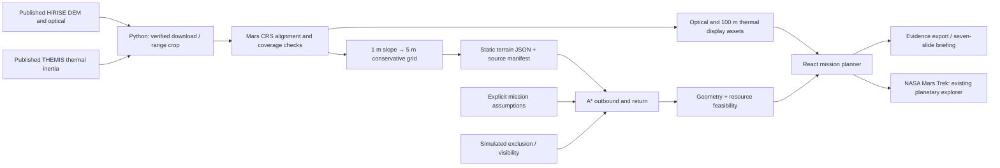

# Architecture

The web app has no backend dependency. React/TypeScript/Vite renders locally computed routes over static scientific assets. `planner.ts` is a deterministic pure module used both by the app and tests. `preprocess.py` does geospatial work offline; `acquire.py` keeps raw data outside the source checkout. No account secrets are embedded. The goal-specific Codex quota guard is outside this application and is never deployed.

Paths `/`, `/evidence`, `/briefing` share the SPA. Static hosting must serve `index.html` for those navigation paths. Production data are local assets, so the core map does not depend on NASA service uptime during a demonstration. External NASA tools open as clearly identified context links.
