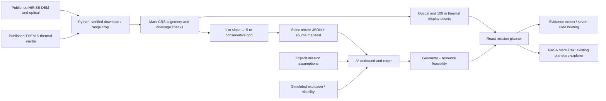

# Architecture

The global `/terrain` entry reuses ArcGIS SceneView and the actual Caltech/Esri Mars imagery/elevation services in Mars WKID 104971. `MarsGlobe.tsx` contains the dynamically loaded SDK boundary, camera operations, physical location markers and sampled DEM queries. `mars-atlas.ts` keeps coordinate and distance math on the Mars sphere. `SurfacePanorama.tsx` is a separate lazy Three.js viewer of locally hosted, actual Mastcam-Z cubemap imagery; it shares Three.js with the local terrain renderer. `/terrain/local` retains the offline-capable quantitative ROI analysis. See `MARS_ATLAS.md` for service/resolution contracts and source credits.

The web app has no backend dependency. React/TypeScript/Vite renders locally computed routes over static scientific assets. `planner.ts` is a deterministic pure module used both by the app and tests. `preprocess.py` does geospatial work offline; `acquire.py` keeps raw data outside the source checkout. No account secrets are embedded. The goal-specific Codex quota guard is outside this application and is never deployed.

Paths `/`, `/evidence`, `/briefing` share the SPA. Static hosting must serve `index.html` for those navigation paths. Production data are local assets, so the core map does not depend on NASA service uptime during a demonstration. External NASA tools open as clearly identified context links.

`/terrain/local` adds a lazy-loaded Three.js analysis workspace. `terrain-analysis.ts` owns deterministic statistics, contour interpolation, physical profile sampling and CSV generation; `TerrainScene.tsx` owns GPU resources, image/raster composition, camera controls and the 2D fallback. `TerrainExplorer.tsx` connects these to the Korean controls and exports. Camera rendering runs on input or resize, without an idle animation loop. Mesh geometry is recomputed only when vertical exaggeration changes; all analysis remains unexaggerated. Terrain preferences are retained in session storage. The production service worker uses Vite's build manifest to precache lazy JS and CSS alongside the existing core assets, and validates those assets before reporting offline readiness.
