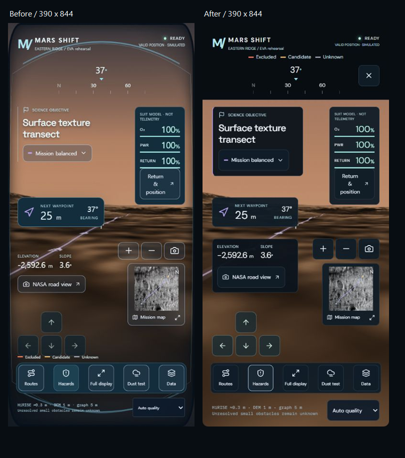

# Flight Deck — design and usability verification

The shared UI implementation and source verification are complete. This report documents browser task walkthroughs and engineering checks, not tests with astronauts, EVA certification, or a guarantee of competition results. Deployment is recorded separately by the hosting platform.

## Result and scope

The shared graphite palette, typography, spacing, navigation, buttons and terrain-panel rules are defined in [DESIGN.md](../DESIGN.md) and implemented in `src/design-system.css`. Native disclosures replace persistent setup/map clutter. The helmet has a visible overview exit, readable text backings and clear simulation/resource labels. Crew defaults to the dark display while retaining daylight mode. Atlas keeps its real services; elevation ramps, numeric units, exaggeration labels and scientific meanings are preserved.

The source integration retains the published helmet/Navcam release (`69a94c0`) and the separate hazard/navigation work. UI changes do not relabel simulated detections as observed obstacles. Actual NASA Navcam geometry remains a **separate recorded station**, not registered terrain at the planned route.

## Capture method and audit

CUA Playwright locators, read-only DOM measurements and the real browser screenshot API were used. Intended CSS viewports are **1440 × 900** and **390 × 844**. Depending on document scrolling, the browser returns 1425 × 891 or 375 × 811 image pixels; immersive views return 1440 × 900 or 390 × 843. Each accepted before/after pair has the same CSS viewport and the same captured pixel dimensions. Original image bytes are retained; only contact sheets scale their thumbnails.

[Capture metadata](design-evidence/verified-captures.json) records 22 final views across 11 routes/states: home, destinations, helmet, explorer overview, Surface XR, crew, planning, terrain analysis, Atlas, evidence and briefing, each desktop/phone. All 22 had no document-level horizontal overflow. Visible `button`, `select` and `summary` boxes in those initial states met the 44 px target check. This is a bounded scan of rendered states, not a claim that every possible dialog state or text link was automatically audited.

Some early Chrome captures contained a previous viewport, a loading placeholder or an unexpected compositor size. Those files under `.local/design-review` are **excluded** from accepted evidence. In particular, earlier files named `*-desktop.png` are not assumed to be desktop proof. The `verified-*` files and matched `baseline-v16-*` files supersede those captures. The baseline v16 is the real published source served read-only from the existing `mars-shift-helmet-v19` checkout, not a recreated mockup.

## Iterative findings and repairs

| Round | Observed problem | Implemented repair | Evidence/result |
|---|---|---|---|
| 1 — hierarchy | Eight operational links competed with the task; a slogan displaced the task name; setup was always exposed | Four primary destinations plus mission library; task heading; native encounter disclosure | Initial and round 1 phone captures retain the same 375 × 811 image size; remaining clipping was not accepted |
| 2 — phone operation | Lazy CSS overrode tokens; transport fell below the scene; navigation clipped; local map obscured the instruction | Root-scoped shared rules, wrapping navigation and reachable transport | Round 2 shows reachable controls but exposed the map overlap, which led to round 3 |
| 3 — map disclosure | Always-open phone inset took the action area | Native Local map disclosure; compact three-group resource strip | Round 3 records the disclosure and a tested 2-second step; it is scrolled and at T+2, so it is intermediate evidence, not an exact pixel comparison |
| 4 — route coverage | Crew/preflight theme, Atlas controls and terrain panels used inconsistent surfaces; NOAH-H was mislabeled as central floor | Shared route tokens and actual region registry labels; shorter page hierarchy | 22 final desktop/phone captures cover every route/state listed above |
| 5 — field controls | Helmet had no touch-accessible overview exit; footer/legend overlapped; bright sky reduced text contrast | Explicit exit; aligned footer and legend; stable graphite contrast backings; removed decorative bezel/blur | Matched v16/current helmet captures at both sizes; exit, dust/HOLD and map flows exercised |
| 6 — final usability | XR-specific flex rules shrank phone navigation; inset parent width caused a scrollbar; enlarged slide dots overflowed; selected slide emphasis was wrong | Explicit nav flex basis; sized inset; two-row slide navigation; current-step styling; Atlas metrics disclosure | Final DOM scan: no page overflow and no undersized visible button/select/disclosure targets in 22 states |

The Surface XR initial/final phone pair uses **NOAH-H, accelerating encounter, seed 6001, SIM T+00**. Intermediate rounds retain their actual state labels. The v16/current helmet pair uses Eastern Ridge, Surface texture transect, initial resources and the same initial view. Crew before/after is also paired at the desktop viewport.

[Surface iterations](design-evidence/surface-iterations.png) · [Helmet desktop comparison](design-evidence/helmet-comparison.png) · [Helmet phone comparison](design-evidence/helmet-mobile-comparison.png) · [Crew comparison](design-evidence/crew-comparison.png)

[All desktop views](design-evidence/desktop-overview.png) · [All phone views](design-evidence/mobile-overview.png). Full-size originals are beside these contact sheets.

## Task walkthroughs

| Flow | Observed result |
|---|---|
| Navigation/library | Primary routes open; library exposes evidence and secondary routes; Escape closes it and returns focus to summary; outside pointer closes it. Modified link clicks retain native browser behavior in source |
| Destination → explorer | NOAH-H and Near-field survey selected through controls; explorer received the chosen region and Near-field observation objective |
| Surface XR | Step advances SIM by 2 s; run/pause changes state; restart resets the encounter; phone map opens/closes; view/setup/evidence controls remain reachable |
| Stale observations | Sensor-dropout scenario stepped to T+30, observation age 18 s: NO VERIFIED ACTION, guidance unavailable, no mint world route. Approach time now says Unverified |
| Crew preparation | Departure is gated on three checks; review action scrolls/focuses the checklist; start changes the phase and next instruction |
| Crew HOLD / return | HOLD pauses movement; return adoption remains disabled while unverified. Position and buddy checks enable resume; return can then be confirmed. At the starting habitat it completes with science explicitly skipped; new-rehearsal confirmation works |
| Dust/position uncertainty | Dust test opens the full observed map with simulated 8 m visibility and localization degraded. Movement is held; assumed fix restoration is explicitly labeled. Clearing the test restores the visor |
| Mission map / NASA station | Large map opens and returns to the surface. NASA road view loads the efficient recorded Navcam mesh, shows the separate-station limitation and closes back to the rehearsal |
| Atlas | Invalid longitude shows a useful error; valid input recovers. Help opens/closes; terrain details expand/collapse; native observation tiles settle before accepted screenshots |
| Briefing | All seven controls display their respective slide; previous/next boundary states disable correctly; current-step highlight and phone layout verified. PowerPoint is a real downloadable file |

A TypeScript AST audit found **238 button declarations** with action bindings or native form submission; none outside a form lacked an action. This checks bindings, not every handler's behavior. The table records actual interactive walkthroughs. Existing mission/scientific tests cover resource, geometry and failure-state logic.

## Accessibility and motion

Keyboard focus uses a visible pale-blue outline; the mission library supports Escape/focus return. Native inputs/disclosures retain their semantics. Hazard state is named in text, not only color. Simulated resource and position labels remain visible. Reduced-motion rules remove transitions/animations, and no new animation dependency or camera loop is installed.

Computed sRGB token contrast against `#0d141c`: primary text **16.42:1**, secondary **9.19:1**, supporting **5.98:1**, action text/background **11.17:1**, warning **10.15:1**, danger **10.30:1**. [Pairs and calculation output](design-evidence/contrast.json). Helmet operational text now has stable dark backings over changing terrain/sky. These values are token checks, not a full WCAG conformance assessment of every raster pixel or third-party map widget.

## Rendering and build evidence

Visible in-app browser, Windows host, Eastern Ridge, helmet camera, Auto quality, DPR 1.25. Existing development F8 test rotates the camera 0.6 radians over five seconds, without advancing the crew. A minimized-Chrome sample was discarded after confirming that the window was minimized.

| Final observed sweep | Frames / 5 s | FPS | Median CPU draw submission | Last asynchronous GPU sample |
|---|---|---|---|---|
| 1440 × 900 | 239 | 47.8 | 0.70 ms | 5.07 ms |
| 390 × 844 | 265 | 53.0 | 0.50 ms | 1.27 ms |

[Desktop measurement](design-evidence/performance-desktop-final.json) · [Phone measurement](design-evidence/performance-mobile-final.json). Earlier visible sweeps were 53.4 and 51.8 FPS. These short samples describe this host and view; they are not a universal rate, thermal endurance test, p95 GPU estimate or controlled before/after regression benchmark. The CSS refinements add no WebGL loop or UI library, and remove expensive decorative blur/bezel effects.

- TypeScript project check passed.
- Vitest: **18 files, 181 tests passed**, final full run 17.63 s.
- Vite production build passed, 1,839 modules, 4.31 s in the local final build. Main JS 344.08 kB / 109.16 kB gzip; Three.js 593.74 kB is a separate lazy chunk. Build timing varies on shared hardware.
- Authored UI diff whitespace check passed against the published baseline. Imported PDS label bytes and frozen scientific source formatting are preserved. Exact integration source is rebuilt again by the Sites publication helper.

## Licenses, scientific boundaries and limitations

[Research and evaluated licenses](DESIGN_RESEARCH.md) · [Existing third-party credits](THIRD_PARTY.md). New UI dependencies: **none**. No Apple asset/font, commercial Magic UI component or competitor code/image is copied. React/Three.js/Lucide and existing fonts retain their credits.

Observed orbital/rover products, derived terrain proxies and simulated weather/resources remain distinct. Global elevation cannot resolve local rocks; native Navcam gaps are not invented away. No live sensor detection, guaranteed escape, calibrated soil-strength probability, human-factors validation or winning guarantee is claimed. The updated surface scenario's research target/misses and actual storm-scale limitations remain in the evidence panel and scientific reports.
