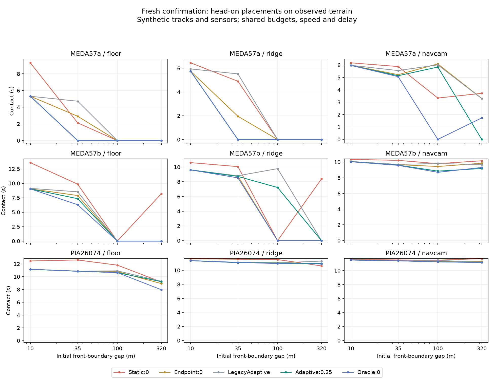
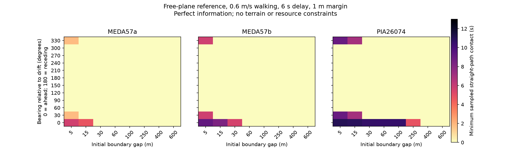

# MARS SHIFT v7 — 배치·거리별 먼지악마 대피 실험

지역적 먼지폭풍이 아닌 **국소 먼지악마**를 대상으로 한다. 실제 관측에서 얻은 크기·병진속도와 실제 Jezero 지형을 사용하지만, 우주비행사 배치·회오리 궤적·위치 센서는 합성이다. 새 실제 관측 사건을 확보한 것으로 세지 않는다.

## 수정과 검증 순서

1. v4/v5/v6 결과와 첫 v7 결과를 보존했다. 최초 protocol.json의 지형/방향 혼동을 실행 전에 protocol-v2.json으로 고쳤으며 원본도 남겼다.
2. 최초 개발/holdout 18/54 사례 이후 실제 귀환 정체를 진단했다. dev-006에서 2초마다 직전 격자로 되돌아오는 같은 부분 구간을 반복했다. 실행 중인 구간의 남은 시간을 모든 모델에 이어주어 귀환 230초 제한 실패를 110초 완료로 수정했다. 회귀 테스트로 고정했다.
3. 새 99개 검증을 고정했다. 54개 방향별 배치 + 45개 동일 조건 거리 사다리다. 일찍 귀환해도 회오리가 지나갈 때까지 평가하며 귀환점은 보호 시설이 아니다.
4. 그 결과를 보고 추정 잡음/짧은 계획 범위라는 가설을 세웠다. 개발용 기존18+별도9 먼 정면 접근 조건에서 3/7표본 추정 × 36초/확장 계획을 비교했다. 아래 개발 결과로 7표본·36초를 선택했다. 확장 계획은 채택하지 않았다.
5. 선택과 α=0.25를 잠근 뒤 **새 72개 조건**을 실행했다. 3 관측 매개변수 × 3 지형 × 4 간격(10,35,100,320 m) × 2 접근/변화 조건이다. 센서 난수·위치·각도를 바꾸었다. 이후 결과를 보고 재조정하지 않았다.

## 공통 정의와 조건

- 명목 접촉: 우주비행사 점과 `회오리 반경 + 1 m` 원의 **엄밀한 내부 교차**. 접선은 접촉시간 0이다. 연속 선분 교차로 샘플 사이 통과도 검출하며 회오리 방향 변화 20초를 반드시 분할한다. 0.5초 탐색과 연속 접촉 평가는 다른 개념이다.
- 거리 G는 최초 중심 거리 D에서 명목 위험반경 R을 뺀 값이다. HUD 경고는 현재 위치에 정지할 때 **민감도 외곽 앞 경계**의 진입 예측이며, 중심 도착 시간이나 기압 최솟값까지의 시간이 아니다. 36초 밖이면 `>36 s`로 표시한다. 검증 지표는 명목 R 기준이다.
- 감지 t=0, 2초 간격 가상 위치 관측, 최초 3관측 확보 t=4. 보행 반응지연 6초(새72개), 실제 이동 시작은 사례별 기록. 경로는 t=0부터 계산하되 XR 지시는 t=4 이후에만 표시한다. 계산 wall time은 측정하지만 합성 시계에 추가하지 않는다.
- 위치 σ=0.75 m, 반경 잡음 max(0.25 m, 0.08r)는 실험 가정이다. 비선형 바람·난류·자연 발생 빈도나 실제 센서 오차 분포를 검증한 값이 아니다. 7개 가상 관측 강건 회귀, 반경은 마지막 측정값 유지. 1σ 민감도 비용 가중치 0.25이며 보정된 확률이 아니다.
- 보행 설정 0.6 m/s, 하중 12 kg, 최대 경사25°. 기존 경사·상승·하중 비용과 0.5초 올림을 공통 적용한다. 실제 이동은 더 느리며 이 비용은 검증된 화성 우주비행사 보행 생리모델이 아니다.
- 모든 모델 동일 산소/배터리520초, 고정 예비량104초, 임무420초. 산소1.12/배터리1.06 배율 소모, 같은 연속 지형 지지면/귀환 검사. 목표귀환 t=70초; 최대360초. `evaluationUntil=max(90,(D+R)/v+25)`까지 회오리 노출을 관찰하고 귀환을 확인한다.
- Jezero 평탄부/능선은 원본 1 m DEM의 81×81 실측 표본 crop. Navcam은 실제 Sol477 스테레오 지형의 0.25 m 격자와 기존 고화질 61개 세부 타일이다. 격자 간격이 지형 정확도를 뜻하지 않는다. Navcam 북/동 좌표와 궤도 DEM 동/남 좌표를 분리했다.
- Static: 공통 자원/지형 제약의 최단시간 목표 경로. Endpoint: 같은 7표본 예측과 24방향 후보 종점. Adaptive: 같은 예측과 시간 확장 탐색/대기/불확실성 비용. LegacyAdaptive: 이전 3표본 추정의 원인 비교. Oracle: 실제 합성 미래를 아는 **같은 제한된 탐색** 기준선이며 전역 최적해/불가피성 증명은 아니다.

## 기존99 검증 — 수정 전 기준을 보존

| Model | No contact | Threat avoided | Contact s | Min clearance m | HOLD s | Return failures | Mean case p95 ms |
|---|---:|---:|---:|---:|---:|---:|---:|
| Static:0 | 40/99 | 2/61 | 5.410 | 8.887 | 29.98 | 0 | 1.7 |
| Endpoint:0 | 41/99 | 3/61 | 5.044 | 8.840 | 23.13 | 0 | 3.0 |
| Adaptive:0.25 | 41/99 | 3/61 | 5.040 | 8.895 | 21.88 | 0 | 92.6 |
| Oracle:0 | 48/99 | 10/61 | 4.477 | 9.497 | 24.30 | 0 | 41.3 |

Adaptive의 평균 접촉 감소는 Static 대비 약6.85%, Endpoint 대비 약0.08%에 불과했다. 전체 무접촉 수에는 원래 비껴가는 상황이 포함되어 있으므로 `Threat avoided`도 따로 제시한다.

## 개발용 분리 실험 — 선택에만 사용

| Model | No contact | Threat avoided | Contact s | Min clearance m | HOLD s | Return failures | Mean case p95 ms |
|---|---:|---:|---:|---:|---:|---:|---:|
| w3-36s | 12/27 | 1/16 | 4.315 | 3.197 | 19.26 | 0 | 101.8 |
| w3-adaptive | 12/27 | 1/16 | 4.353 | 3.064 | 19.48 | 0 | 119.1 |
| w7-36s | 14/27 | 3/16 | 3.792 | 3.682 | 19.93 | 0 | 99.1 |
| w7-adaptive | 13/27 | 2/16 | 4.076 | 3.078 | 19.63 | 0 | 114.1 |

7표본·36초가 최소 접촉을 보였다. 36초를 늘린 구현은 긴 범위에서 종점 후보군을 사용하므로 순수한 시간 길이의 효과만을 분리한 것은 아니다. 이 복합 변경은 채택하지 않았다. 수치가 좋게 나오도록 검증세트에서 가중치를 재조정하지 않았다.

## 새72개 확인 실험 — 모델별360회 실행

| Model | No contact | Threat avoided | Contact s | Min clearance m | HOLD s | Return failures | Mean case p95 ms |
|---|---:|---:|---:|---:|---:|---:|---:|
| Static:0 | 28/72 | 6/48 | 5.570 | 9.980 | 40.33 | 0 | 2.0 |
| Endpoint:0 | 32/72 | 8/48 | 4.758 | 10.111 | 33.97 | 0 | 3.8 |
| LegacyAdaptive | 31/72 | 7/48 | 4.985 | 9.792 | 30.25 | 0 | 176.8 |
| Adaptive:0.25 | 34/72 | 10/48 | 4.697 | 10.180 | 32.03 | 0 | 164.1 |
| Oracle:0 | 35/72 | 11/48 | 4.496 | 10.385 | 34.14 | 0 | 67.0 |

- Adaptive vs Static:0: 접촉 감소 41 / 증가 4 / 동일 27 사례; 평균 차이 -0.8729 s.
- Adaptive vs Endpoint:0: 접촉 감소 27 / 증가 3 / 동일 42 사례; 평균 차이 -0.0610 s.
- Adaptive vs LegacyAdaptive: 접촉 감소 27 / 증가 1 / 동일 44 사례; 평균 차이 -0.2879 s.

HOLD에는 공통 반응지연·목표 도착 후 대기·노출 관찰이 포함된다. 감소가 모두 불필요한 HOLD 제거를 뜻하지 않는다. 귀환 실패가 모두0이면 감소를 입증한 것이 아니다. 계산시간은 같은 로컬 호스트에서 측정한 사례별 p95의 평균이며 엄격한 전용 장비 벤치마크가 아니다.

## 방향·거리의 물리적 기준

별도 평지 참고 실험 3,240개 합성 조합: 3관측 크기/속도 × 3보행속도 × 3지연 × 12방향 × 10거리. HOLD, 초기 중심에서 방사상 멀어지기, 진행방향 수직 양쪽, 720개 직선 방향을 비교했다. 기존2,592개 geometry.json도 보존했으며 서로 독립 관측이 아니다. 기존 `oppositeContact`는 병진속도 반대 방향이며 방사상 멀어지기와 다르다.

정면 직선 접근, v>u일 때 완전정보·무제약 평지에서 무접촉 가능 경계는

`G_min = v L + R(v/u − 1)`, `front-warning = G_min/v`, `theta = acos(u/v)`.

이 방향은 회오리 진행방향에 대해 양옆으로 비스듬하다. 아래 표는 보행u=0.6 m/s, 지연L=6초, 여유1 m이며 지형·센서오차를 포함하지 않는 참고 하한이다.

| Source | Diameter m | Drift m/s | Front gap m | Front warning s | Direction from drift deg |
|---|---:|---:|---:|---:|---:|
| MEDA57a | 9.13 | 1.680 | 20.10 | 11.96 | 69.1 |
| MEDA57b | 18.87 | 1.910 | 34.24 | 17.93 | 71.7 |
| PIA26074 | 60.00 | 5.278 | 273.35 | 51.79 | 83.5 |

따라서 작은 먼지악마라도 매우 가까운 정면 접근을 항상 완전히 피할 수 있는 것은 아니다. 이미 내부인 경우에는 예방률과 분리해 잔여 접촉시간을 줄이는 문제가 된다. 옆이나 뒤에서 이미 비껴가는 경우의 이동은 새 위험 진입을 만들 수 있어 HOLD도 후보에 둔다. 지형에서는 단순한 반대 방향 대신 실제로 지지되는 경로와 시간별 교차를 비교한다.

## 예측 오차 — 합성 센서에서만 측정

| Motion | Tracker | Lead s | Synthetic position RMSE m | Radius MAE m |
|---|---|---:|---:|---:|
| linear | LegacyAdaptive | 5 | 2.678 | 0.960 |
| linear | LegacyAdaptive | 10 | 4.512 | 0.960 |
| linear | LegacyAdaptive | 20 | 8.220 | 0.960 |
| linear | Adaptive:0.25 | 5 | 1.298 | 0.960 |
| linear | Adaptive:0.25 | 10 | 1.896 | 0.960 |
| linear | Adaptive:0.25 | 20 | 3.127 | 0.960 |
| turn | LegacyAdaptive | 5 | 2.692 | 0.991 |
| turn | LegacyAdaptive | 10 | 4.708 | 0.991 |
| turn | LegacyAdaptive | 20 | 9.181 | 0.991 |
| turn | Adaptive:0.25 | 5 | 1.737 | 0.991 |
| turn | Adaptive:0.25 | 10 | 3.032 | 0.991 |
| turn | Adaptive:0.25 | 20 | 6.287 | 0.991 |
| growth | LegacyAdaptive | 5 | 2.715 | 1.022 |
| growth | LegacyAdaptive | 10 | 4.578 | 1.047 |
| growth | LegacyAdaptive | 20 | 8.343 | 1.140 |
| growth | Adaptive:0.25 | 5 | 1.251 | 1.022 |
| growth | Adaptive:0.25 | 10 | 1.825 | 1.047 |
| growth | Adaptive:0.25 | 20 | 3.006 | 1.140 |

5/10/20초 앞 예측을 t=4..80초에서 측정했다. 같은 사건 안의 예측들은 상관되어 있다. 7표본은 직선에서 잡음을 줄여도 회전 시 지연을 만들 수 있다. 크기 모델은 바꾸지 않았으므로 반경 정확도 개선을 주장하지 않는다. 실제 영상 픽셀 오차 및 실제 MEDA 압력 측정 결과는 기존 `docs/OBSERVED_V6_RESULTS.md`에 별도로 남아 있다. 이를 실제 지상 미터 위치 오차와 혼합하지 않았다.

## 실패 기록과 다음 개선의 기준

최종 확인 실험에서도 Endpoint보다 나빠진 사례는 3개다. 특히 `confirm-036` (MEDA57b, 능선, 정면, 100 m 간격)은 Adaptive 7.218 s, Endpoint 0 s, Oracle 0 s다. 나머지는 confirm-054 (9.225 vs 8.926 s), confirm-062 (10.972 vs 10.918 s)다. 이 사례를 확인한 뒤 가중치를 바꾸지 않았다. 평균 개선이 사례별 우월성을 보장하지 않는다. 추가 사후 진단(regression-diagnostic.json)에서는 t=6~18초에 통합 모델이 불확실성 비용 때문에 Endpoint와 다른 경로를 선택했고, t=24초의 통합 모델 위치에서는 완전정보 경로도 다음36초에 약2.3초 접촉했다. t=30초에는 명목 예측 접촉0초인 경로가 합성 참값으로 약8.5초 접촉했다. 이는 초반 경로 선택과 이후 추정 오차가 결합한 실패이며, 같은 위치에서 마지막 순간 방향만 바꾸는 것으로 해결되지 않았다. 이 진단은 수정 효과를 검증한 추가시험이 아니다.

Adaptive 무접촉은 평탄부13/24, 능선12/24, 제한된 Navcam9/24다. 기존 NOAH/THEMIS 지반 후보 기능은 보존했지만, 이번 로컬 격자에 등록된 연약지반 정답이 없으므로 이 비교에 별도의 Sand Trap 확률을 넣지 않았다. 광학 먼지 기둥 직경도 물리적으로 검증된 위험 풍속 경계가 아니다.

별도 warm-planner 측정: 18개 고정 상태에서 2회 예열 후 각10회, 총180회. p50 168.1 ms, p95 258.5 ms, 최대289.6 ms, 2초 초과0회. 지형 로딩·작업자 통신·렌더링을 제외하며 다른 데스크톱 작업을 통제한 실시간 보장은 아니다. 원시 반복시간은 timing.json에 있다.

`failure-diagnostics.json`은 실패마다 감지·추정완료·지시 가능·첫 이동·귀환 시작, 최소 이격, 접촉 구간, 최소 귀환 여유를 기록한다. `paired-confirmation.csv`는 모든 모델 동일 사례 비교이고, 원본 JSON에는 매2초 행동/위치/예측 접촉/탐색량이 있다. Oracle도 접촉한 사례는 제한된 관측 지형·보행비용·계획 범위가 함께 작용할 수 있으며 물리적으로 피할 수 없다고 단정하지 않는다.

실제 적용으로 가려면 원격 거리·방향을 동시에 측정한 위치 정답, 회오리 경계의 물리적 정의, 지형 정합 오차와 보행속도 자료가 필요하다. 지금 확보된 단일 지점 MEDA 압력/바람만으로 원격2D 궤적을 만들지 않았다. 시뮬레이션은 안전 보장·실제 부상률 검증이 아니다.

## 재현 및 자료

`node scripts/run_encounters_v7.mjs <development|holdout|validation|ablation|confirmation>`은 기존 산출물이 있으면 덮어쓰기를 거부한다. 재현하려면 별도 사본에서 해당 출력만 분리한다. 단계별 소스 스냅샷은 `docs/source-snapshots`에 있고 protocol/result/engine SHA256을 저장했다. 원자료 출처는 다음과 같다.

- [Hueso et al. 보충자료 Table S3](https://doi.org/10.5281/zenodo.7315863): MEDA57a/57b의 사후 적합 직경·병진속도. 센서풍속을 회오리 병진속도로 대신하지 않았다.
- [NASA Sol899 영상 설명](https://science.nasa.gov/resource/martian-whirlwind-takes-the-thorofare/): 약60 m 직경, 약19 km/h 이동. 이 한 사건을 모든 먼지악마의 대표분포로 취급하지 않는다.
- [MEDA 공식 PDS](https://atmos.nmsu.edu/PDS/data/PDS4/Mars2020/mars2020_meda/): 이전 단계에서 확보한 실제 압력/바람과 재생을 보존.
- [Jezero DEM 공개 데이터](https://doi.org/10.22002/stqse-yay61): 실제1 m 표본 지형. crop와 SHA256은 floor/ridge-terrain.json에 기록.
