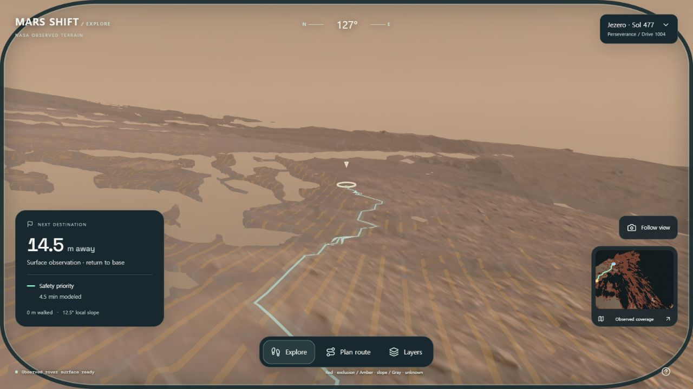

# Observed surface exploration — 15 November 2026

## Decision

Keep Three.js and improve the existing explorer. The main `/explore` view now opens a walking scene built from NASA/JPL-Caltech Perseverance Drive 1004 (Sol 477) meshes, rather than opening rover imagery in a detached viewer. Orbital Jezero planning remains available from the site selector. These are separate coordinate frames: this release does not assert an unmeasured registration between the rover site and the existing orbital study regions.

The public demonstration is **Explore → Plan route → Layers**. Select a destination on the observed surface, compare shortest, lower-exposure and modeled-time routes, and walk with WASD. Drag to look, scroll to zoom, C for helmet/follow camera, M for the large map, H for the constraint layer, Escape to explore. Touch movement controls are available on narrow screens. The weather rehearsal keeps its existing model and moves secondary analysis into expandable panels.

## Rendering diagnosis and changes

| Cause | Finding | Change and boundary |
| --- | --- | --- |
| Camera | Orbital imagery viewed obliquely stretches a finite number of pixels across the foreground. An elevated camera also weakens the sense of scale. | 1.7 m helmet eye height; true metre scale; restrained downward view; follow camera and scroll remain available. |
| Geometry | A 1 m orbital DEM cannot contain every small rock. | Preserve orbital DEM and registration unchanged. Add actual rover stereo meshes only in their published local frame. No generated rocks or ground infill. |
| Texture | Available sample atlases are typically only 512 pixels wide. Magnifying a parent tile cannot restore missing pixels. | Default to finest available original leaf tiles, native image dimensions, anisotropic filtering up to hardware limit/16. JPEG95 conversion preserves dimensions, not lossless image bytes. |
| Lighting | Observed imagery already contains real illumination. Relighting it as an uncalibrated material can introduce misleading shadows. | Preserve source unlit terrain materials. Use restrained environmental lighting for the illustrative crew; a visual contact shadow does not modify terrain. |
| Detail/performance | Full source collection is unnecessarily expensive for a bounded walking demonstration. | Selected native assets: 66 meshes, 1,045,833 triangles, 28.9 MB. Efficiency mode: 21 meshes, 411,043 triangles, 10.0 MB. Four concurrent downloads, frustum culling, DPR cap 1.5, render only when changed, disposal on surface changes. |

The new Blender-prepared NASA EMU derivative has 57,160 triangles, seven materials and nine original rig bones, with fabric normals and refined helmet/hardware presentation. It is an illustrative crew model, not a scanned astronaut or validated Mars pressure suit. There is no motion-capture or independent foot IK claim.

## Scientific boundary

The rover integration does not replace or reweight the existing orbital terrain, mobility or hazard engines. The latest concurrently published spatial release (88b5567), including its planner fixes, was merged intact before final validation. A separate local graph adapter reuses their costs and resource metrics while requiring each graph edge to pass the same swept support/grade checks used by walking. Native mesh heights are sampled at 0.25 m graph spacing; this is **not positional accuracy**. Unknown cells, steep slopes, footprint margins and user exclusions block traversal. A reviewed annotation is a user judgment, not independently verified boulder truth. Simulated obstacles are explicitly tagged.

Route ribbons are display overlays. Their vertices sample the mesh-derived navigation height with a 6 cm display offset to avoid z-fighting. This display adjustment never changes collision or route costs. Coarse visual LoD can differ slightly from the navigation surface. The actual NASA source geometry is not sculpted.

There are 9,443 known cells and 2,695 cells after the configured conservative masks. Only 36.9% of the rectangular grid has supported observations. Context meshes improve the surroundings but do not extend the navigation graph. Gaps remain visible; they are not made safe through rendering.

## Reproducible local calculation

Run `pnpm science:rover`. Machine-readable results are in `public/data/drive1004/navigation-results.json`.

| Objective | Round trip | Modeled total, including 2 min work | Maximum sampled slope |
| --- | ---: | ---: | ---: |
| Shortest | 31.770 m | 4.816 min | 24.943° |
| Lower exposure | 33.517 m | 4.482 min | 16.774° |
| Modeled time | 33.226 m | 4.481 min | 16.774° |

Assumptions: 0.6 m/s nominal speed, 12 kg modeled load, 25° slope ceiling, 20-minute mission, 30-minute oxygen/power proxies, 25% reserve. Lower-exposure is faster here because it avoids steep terrain in the declared mobility model. These are not calibrated EVA physiology or globally optimal resource-constrained paths.

The reproducible 0.65 m simulated obstruction at (-4.125 m north, 11.375 m east), plus clearance, blocks every tested default alternative. The correct result is **NO FEASIBLE ROUTE**, not a fabricated replacement. In browser review, a different manually placed exclusion caused a real detour, increasing the displayed modeled total from 3.6 to 3.7 minutes for the shortened target.

## Existing approaches reviewed

- [NASA DERT](https://github.com/nasa/DERT): Java desktop DEM/orthophoto visualization, terrain measurements, ground-level cameras and raster quadtrees. Its analysis/layer design is a reference, not embedded code. NASA Open Source Agreement. Replacing the browser with DERT would not increase source resolution.
- [NASA-AMMOS TIG](https://github.com/NASA-AMMOS/tig): a genuine offline disparity → XYZ → mesh → GLB pipeline for suitable paired VICAR camera products and calibration. Apache-2.0 software, with separate component/data conditions. [The mesh demo](https://github.com/NASA-AMMOS/tig/blob/develop/docs/demos/mesh-generation.md) includes `maxgap=5`; any filled geometry needs an inference mask before navigation use. TIG was evaluated, not run or claimed as our reconstruction method.
- [CesiumJS](https://github.com/CesiumGS/cesium): useful globe/terrain/3D Tiles streaming infrastructure, Apache-2.0. A Mars frame and ellipsoid must be explicitly configured. Migration would not recover detail missing from the present sample atlases.
- [NASA-AMMOS sample data](https://github.com/NASA-AMMOS/3DTilesSampleData/tree/76444abbb4faff1b05f46a09b81ca2c24602b333/m20-drive-1004): directly reused Landform-produced geometry, published transforms and imagery. No claim that the data is Apache-licensed. See `DRIVE1004_ASSETS.md` for NASA/JPL media attribution and conversion checks.
- [Apple spatial design](https://developer.apple.com/design/human-interface-guidelines/designing-for-visionos/): applied progressive disclosure, stable horizon, legible panels and restrained motion. This is design guidance, not an Apple open-source skill, native visionOS app, or headset WebXR implementation.

## Validation

- 194 tests passed after integrating the latest spatial release, including six new local-coordinate, swept-collision, obstacle, original-base return, hard-budget and actual-source route tests. Two earlier full-suite timeouts passed when rerun without competing heavy work; test assertions and deadlines were not weakened.
- Both Python asset validators passed: all 82 distinct exported mesh accessor arrays and image dimensions match source; 64 independent triangle intersections agree with rounded exported heights to 4.791 micrometres. That is conversion consistency, not measurement accuracy. Crew dimensions, skin weights and topology checks passed.
- Same-camera efficiency/native screenshots: eye position `[1.375, 1.71491, 5.375]` m, FOV 57°, identical quaternion verified from the live canvas. Images compare original parent versus finest available leaf assets at this source region, not different regions or AI enhancement. The quality improvement is bounded by the original sample imagery; close ground remains less detailed than a full-resolution reconstruction.
- Browser checks cover target selection, obstacle detour/removal, detail switching, ground overlays, helmet/follow camera and keyboard movement. Performance measurements and screenshots are recorded with this release. Desktop results must not be treated as a guarantee for all GPUs or mobile devices.

## Next real resolution improvement

Acquire geometrically compatible higher-resolution stereo camera products and calibration, run a reproducible TIG/Landform reconstruction, preserve confidence and infill masks, and independently validate registration. Installing another renderer or adding synthetic rocks does not supply those observations.

## Recorded browser evidence

At 1280 × 720 and device pixel ratio 1.25, deterministic 5-second camera sweeps measured **60.16 fps** in native helmet view (803,353 rendered triangles / 45 calls at the final angle) and **60.05 fps** including the crew (884,721 triangles / 59 calls). These measurements use the development build in the desktop in-app Chromium browser on this machine; they are not phone benchmarks or frame-latency percentiles. The idle scene stops submitting unchanged frames.

A 390 × 844 responsive check confirmed touch movement (1.1 m during a 1.8 s press), readable panels, working destination controls and the explicit no-feasible-route scenario. The previous orbital 1 m DEM mode and hazard rehearsal frame advance were also checked. WebGL startup failure has a visible retry/region fallback; loss of WebGL support was not artificially induced in this browser.

[Performance record](rover-evidence/performance.json) · [Mobile](rover-evidence/mobile-explore.jpg) · [Route comparison](rover-evidence/route-comparison.jpg) · [Reviewed exclusion detour](rover-evidence/reviewed-obstacle-detour.jpg) · [Hazard rehearsal](rover-evidence/hazard-rehearsal.jpg)

Same eye position, orientation and FOV — parent efficiency assets:

Finest available source leaves:

The difference is incremental. Neither image is claimed to show raw-camera photorealism or complete stereo coverage.
