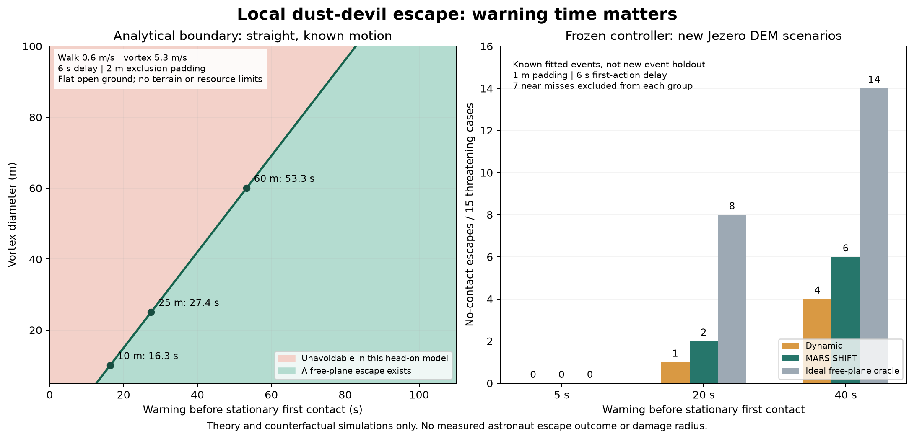

# 화성의 국지적 먼지 회오리: 대피 가능 조건 연구

2026-11-15 KST · Exa 3개 조사축, 검색 결과 25건, 중복 제거 23개 URL.
물리 관측, 다중 센서 추정, 보행·이동 장애물 회피를 조사했다. 원 연구·NASA·저자 공개 자료를 우선했다.
검색 등록부는 [search-register.json](search-register.json).

**연구 대상은 먼지악마(dust devil), 즉 모래 토네이도처럼 보이는 국지적 대류 회오리다.**
지역 규모 먼지폭풍, 우주복 손상, 헤드셋 안전성은 이번 실험 대상이 아니다.
핵심 가설은 “작은 회오리를 충분히 일찍 탐지하면 이동 경로 밖으로 비켜설 수 있다”이다.
직경이 작다는 사실만으로 모든 접근 조건의 대피가 가능해지는 것은 아니다.

## 관측 연구가 바꾸는 모델

[Hueso et al. (2023)](https://doi.org/10.1029/2022JE007516)은 Jezero의 압력·바람 자료에
이동 회오리 모델을 적합했다. [원본 Table S3](https://doi.org/10.5281/zenodo.7315863)의 22건은
직경 4.84–134.7 m, 이동 속도 1.17–6.38 m/s다. 강하고 먼지가 많고 바람 신호가 뚜렷한
근접 사건을 선택한 표본이므로 전체 발생 빈도나 대표 회피 확률로 일반화하지 않는다.
논문의 직경은 **최대 회전 풍속이 나타나는 회오리의 직경**이며 카메라의 먼지 기둥 폭과 다르다.
MEDA는 주로 1 Hz, 일부 센서는 2 Hz로 측정하지만 이는 위치가 1–2 Hz로 직접 관측된다는 뜻이 아니다.

[Murdoch et al. (2022), 표 1](https://www.nature.com/articles/s41467-022-35100-z/tables/1)의
sol 215 사건은 직경 25.0±1.56 m, 이동 속도 5.3±0.3 m/s로 추정됐다.
[같은 논문의 영상 해석](https://www.nature.com/articles/s41467-022-35100-z)은 먼지 구름의
겉보기 폭이 약 11 m여도 회오리 직경은 약 25 m일 수 있음을 보여준다. 카메라 폭을 안전 경계로
바로 쓰면 작게 잡을 수 있다는 경고 사례다. 마이크의 25 kHz는 음향 표본률이며 위치 추적률이 아니다.
표의 오차는 최상위 적합 해들의 산포이므로 독립적인 위치 정답의 오차나 보정된 사고 확률로 쓰지 않는다.

[Spirit 연구](https://agupubs.onlinelibrary.wiley.com/doi/full/10.1029/2006JE002743)는 많은 먼지악마가
10–20 m 직경이라고 보고했다. 작은 근거리 회오리와 궤도 영상에서 잘 보이는 큰 회오리를 한 분포로
섞지 않는 것이 중요하다. 이는 관측 방식의 선택 편향을 고려한 연구 설계 판단이다.

[부분 중력 보행 실험](https://doi.org/10.1038/31374)은 약 0.4 g에서 보행 역학을 측정했지만,
실제 화성의 우주복·바위 지형에서 일정한 속도를 보장한 실험은 아니다. 0.4/0.6/0.9 m/s를
보행 가정으로 분리하고, 지형 시험에서는 기존 부하·경사 이동 모델을 유지했다.

**자료 신규성 정정:** 원본을 다시 확보하여 MD5를 검증했으나 22건 모두 초기 `observations.json`의
중앙값과 일치했다. 새 독립 관측 22건이 아니다. 이번의 새 작업은 원본 불확실성 확인, 정확한 접촉
계산, 경고 시간별 실험과 미탐 측정이다. sol 215의 Sigma_Diam=-1.23은 오류 의심 값으로 보존·표시하고
오차 확률에 사용하지 않았다. 사전 문서와 정정 내용은 `docs/DUST_DEVIL_ESCAPE_PROTOCOL.md`,
`docs/DUST_DEVIL_ESCAPE_AMENDMENTS.md`에 각각 보존했다.

## 정면 접근의 이론적 경계

[Velocity Obstacles](https://doi.org/10.1177/027836499801700706)의 상대속도 관점을 사용해
아래 단순한 경우를 직접 유도하고 수치 검증했다. 원형 회오리가 일정한 속도 v로 정면 접근하고,
사람의 최대 속도가 u<v, 행동 지연이 L, 배제 반경이 R일 때 필요한 최소 경고 시간은:

**T_min = L + R/u − R/v**

T는 “사람이 계속 서 있으면 처음 경계에 닿을 때까지”의 시간이다. 경고 시 중심 거리로는
**D_min = vL + Rv/u**다. 경계와의 접촉을 엄격하게 피하려면 이 값보다 더 여유가 있어야 한다.

유도: 지연 후 중심 거리 D에서 회오리 중심이 출발점을 통과하는 D/v초 뒤, 사람의 모든 도달 가능한
위치는 반경 uD/v의 원 안에 있다. uD/v<R이면 어떤 방향 변경을 해도 그 시점에 경계 안이다.
반대로 cos(θ)=u/v인 일정 방향 이동은 최소 분리 거리 Du/v를 달성한다. 따라서 이 제한된
정면·평지·등속 조건에서는 필요조건과 충분조건이 일치한다. 회오리 이동 방향과 거의 직각인
방향이 해가 되며, 무조건 회오리 진행 방향으로 달아나는 방식은 더 나쁠 수 있다.

아래는 v=5.3 m/s, u=0.6 m/s, R=직경/2+**가정한 2 m 여유**일 때다.

| 직경 | 사용 가능한 추적 이후 지연 2초 | 최초 센서부터 행동까지 지연 6초 |
|---|---:|---:|
| 10m | 12.3초 | 16.3초 |
| 25m | 23.4초 | 27.4초 |
| 60m | 49.3초 | 53.3초 |
| 280m | 211.9초 | 215.9초 |

2 m는 의학적 피해 범위나 실제 바람의 끝을 뜻하지 않는다. 장애물·경사·가속·넘어짐은
이 식에 없으므로 실제 지형에서는 더 많은 경고가 필요하거나 경로가 없을 수 있다.
모든 방향·시간가변 회오리에 이 정면 경계를 적용해 '대피 불가능'이라고 판정하지 않는다.



## 실행한 실험

- 7,200개 직경·이동 속도·보행·경고·지연·횡방향 거리 조합. 각 조합에서 HOLD,
  뒤로 달아나기, 옆으로 이동, 실제 상태를 아는 720방향 참고 경로를 비교했다.
- 시작부터 내부인 9개 조건은 별도 진단이다. 완전 정보여도 초기 접촉 자체를 없앨 수 없다.
- Jezero 실제 DEM 위에서 22건 × 5/20/40초 경고 × 3모델 = **198회**.
  기존 v4 가중치는 바꾸지 않았다. 센서 첫 측정 t=0, 2초 간격의 가상 2D 위치 관측,
  3점 추정 완료 4초 + 반응 지연 2초로 첫 움직임은 t=6이다.
- 이 DEM 비교는 기존 v4의 1 m 여유를 유지한다. 위 이론 그림의 2 m와 구분한다.
  관측으로 추정한 직경·속도를 사용했지만 배치·방향·위치 센서 잡음은 가상이다.
  실제 영상 궤적 예측의 독립 평가를 새로 실시한 것이 아니며 v4의 혼합된 영상 결과는 유효하다.
- 움직임 구간과 회오리 궤적의 연속 교차 시간을 이차방정식으로 계산했다.
  빠른 작은 회오리가 샘플 사이를 통과해 노출이 0으로 잘못 기록되는 문제를 피했다.

전체 22개 중 7개는 원래 비껴가는 조건이다. 이를 제외한 **실제로 정지 위치에 접근하는 15개**에서
아예 접촉하지 않은 횟수는 다음과 같다.

| 정지 시 접촉까지 남은 시간 | 정적 | 이동 예측 | MARS SHIFT | 완전 정보·평지 참고값 |
|---|---:|---:|---:|---:|
| 5초 | 0/15 | 0/15 | 0/15 | 0/15 |
| 20초 | 0/15 | 1/15 | 2/15 | 8/15 |
| 40초 | 0/15 | 4/15 | 6/15 | 14/15 |

40초 경고에서도 현재 통합 엔진은 15건 중 6건만 완전 회피했다. 완전 정보·평지에서는 14건에
회피 경로가 있었다. 지형·부하·센서 오차·후보 경로 제한·30초 예측 지평이 차이의 원인 후보다.
각 요인의 기여도는 분리 실험이 필요하다. 모두 알고리즘 버그나 지형 탓이라고 단정하지 않는다.
현재 엔진은 평균 노출은 줄여도 피할 수 있는 모든 사건을 놓치지 않는 수준은 아니다.
198회 모두 지형 위반과 복귀 예산 실패는 0이었지만 예산은 넉넉하게 동일 설정했다.
이 결과는 자원 한계 시험이 아니며 이전 v4의 낮은 예산 시험을 대체하지 않는다.

## 충돌 위험을 놓친 비율

고정된 출발점에서 HOLD할 때 향후 원형 경계가 닿는지를 평가했다. 모든 경고 방식은 같은
센서·좌표·숨겨진 궤적을 사용한다. 아래 분모는 **서로 상관된 예측 시점 창**이며 독립 사건 수가 아니다.
이미 내부인 창 358개와 추정 준비 중 198개 창은 별도 집계했다. 이는 가상 위험 미탐률이며
실제 화성 우주비행사의 충돌 미탐률이 아니다.

| 예측 지평 | 명목 경고 미탐 FN/(TP+FN) | 불확실성 경고 미탐 | 불확실성 경고 오경보 FP/(FP+TN) | 준비 중 위험 창 |
|---|---:|---:|---:|---:|
| 5초 | 11/74 (14.9%) | 0/74 | 347/1644 (21.1%) | 30 |
| 10초 | 18/134 (13.4%) | 0/134 | 512/1584 (32.3%) | 45 |
| 20초 | 40/254 (15.7%) | 0/254 | 728/1464 (49.7%) | 75 |
| 30초 | 61/329 (18.5%) | 0/329 | 865/1389 (62.3%) | 90 |

30초 지평에서 불확실성 경고의 준비 완료 후 미탐은 0/329였지만, 오경보는 865/1389였다.
첫 6초 동안 예측 자체가 없던 위험 창 90개를 포함하면 경고를 제공하지 못한 창은 **90/419**다.
따라서 '미탐 0%'만 표시하면 오해다. 불확실성 영역을 크게 잡은 경고는 이번 실험에서 미탐을 줄이고
오경보를 늘렸다. HOLD 증가에 미치는 영향은 별도 분리 실험이 필요하다. 경고 분류와 경로 선택은 별도 지표다.

## 연구 방향과 구현상 의미

1. 목표를 평균 노출 감소 외에 **회피 가능한 사건의 무접촉 회피율**로 설정한다.
2. 카메라 위치·거리·시각이 함께 있는 연속 데이터를 확보하고 카메라, 기압·바람을 함께 추정한다.
   눈에 보이는 먼지 폭과 회오리 직경은 별도 상태로 둔다. 근접 압력·음향 신호만으로 원거리 조기경보가
   가능하다고 가정하지 않는다.
3. 긴 선행 경보와 짧은 정밀 재계획을 분리한다. 큰 회오리에서 R/u가 30초를 넘으면 현재 지평만으로
   충분한 회피 준비가 되는지 확인해야 한다. 이는 다음 검증할 가설이며 이번에 새 설정을 배포하지 않았다.
4. XR에는 '예측 준비 중', '경고는 있으나 경로 미확인', '노출 감소 경로'를 구분한다.
   경고의 미탐·오경보와 남은 횡이동 시간을 표시하는 설계 근거로 이 결과를 사용한다.

결론의 범위: 국지 먼지 회오리는 조건에 따라 옆으로 벗어날 수 있다는 물리적 근거가 있다.
현재 자료와 실험은 그 조건을 정량화한다. 실제 현장 대피 성능이나 인체 피해 감소를 검증한 것은 아니다.

## 재현 및 파일

`src/dust-devil-geometry.ts`가 연속 접촉 계산과 도달 가능성 경계 코드다.
`scripts/analyze_dust_escape_study.ts`가 7,200조건과 198회 실험을 실행한다.
`public/data/hazards/dust-escape-geometry.json`, `dust-escape-terrain.json`, `dust-escape-summary.json`에
전체 결과를 보존했다. 원본 XLSX의 MD5는 `7efe9e5281ef6b535d17e956da0fe986`, 이용 조건은 CC BY 4.0이다.

```powershell
python -X utf8 scripts/acquire_jezero_vortices.py
node scripts/run_dust_escape_study.mjs geometry
node scripts/run_dust_escape_study.mjs terrain
../research/.venv-hazards/Scripts/python.exe scripts/report_dust_escape_study.py
node node_modules/vitest/vitest.mjs run
node node_modules/typescript/bin/tsc -b
node node_modules/vite/bin/vite.js build
```

기존 v4 자료와 XR 동작을 유지했다. 본 연구는 원본 자료를 재확인한 탐색적 실험이며
새 독립 사건에 대한 검증으로 홍보하지 않는다.

검증 기록: 2026-11-15 KST, Vitest 20개 파일·196개 테스트 통과(새 연속 접촉·경계 검증 6개 포함),
TypeScript `tsc -b` 통과, Vite production build 통과. 실행 로그는
`../research/dust-escape-all-tests.log`, `dust-escape-typecheck.log`, `dust-escape-build.log`에 보존했다.
그림을 재현할 Python 의존성은 `scripts/requirements-local-dust.txt`에 고정했다.
