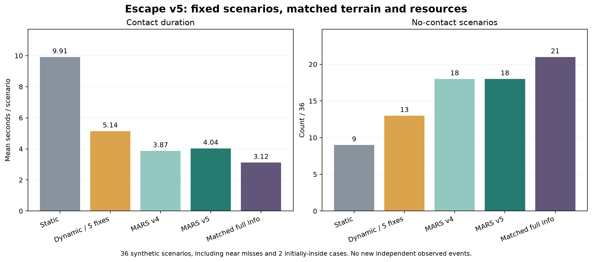

# MARS SHIFT: 대피 경로 v5 검증·개선 기록

2026-11-15 KST. 기존 결과 파일의 SHA-256을 검사해 변경되지 않았음을 확인했다.
프로토콜: `docs/ESCAPE_V5_PROTOCOL.md`, 진단 후 선택 근거: `docs/ESCAPE_V5_SELECTION.md`.
원본 자료는 [Hueso et al. Table S3](https://doi.org/10.5281/zenodo.7315863)의 이미 사용한 모델 추정값이다.
이전 7,200조건은 합성 조합이고, 이번 36개 평가 시나리오도 독립적인 실제 관측이 아니다.

## 1. 정의와 회귀 검증

경고 W는 **정지한 출발점에 위험영역의 앞쪽 경계가 처음 닿을 때까지**다.
정면 등속 접근에서는 중심 도착 시간이 W+R/v다. 기존 16·27·53초는 2m 여유를 더한
앞쪽 경계 기준이며, 중심 기준은 각각 약 17.7·30.2·59.3초다(보행 0.6, 이동 5.3m/s, 지연 6초).
그 결과를 수정하거나 덮어쓰지 않았다. 새 비교는 모든 모델에 R=관측 모델 반경+1m를 적용한다.
접촉은 경계 내부에 양의 시간 동안 있는 것이며 접선 접촉 시간은 0이다. 무접촉 수치 허용값은 1e-8초다.

최초 감지 t=0, 0/2/4초 관측, 추정 준비 t=4, 2초 전달·반응 지연 후 최초 계획/이동 가능 t=6.
첫 실제 이동은 HOLD 여부에 따라 더 늦어질 수 있다. 실제 계산 소요시간은 따로 측정하며
가상 동역학에 중복 가산하지 않는다. 실제 감지 장치의 탐지 성능을 입증한 실험이 아니다.
성장·회전 사례의 W는 최초 배치 기준이다. 실제 정지점 접촉 시작 시각을 별도 계산해 CSV에 저장했다.

해석식과 실제 궤적 교차를 대조하고 빠른 0.02초 접촉, 접선, 반경 증가, 방향 전환,
1/0.5/0.1/0.01초 분할에 대한 연속 접촉 불변성을 회귀 검사했다. 실행 평가뿐 아니라
새 경로 후보의 접촉 비용에도 연속 구간 교차 검사를 적용했다. 반경이 선형 변화하는 구간의
최소 이격은 볼록 1차원 수치 최소화로, 고정 반경은 해석식으로 계산한다.

## 2. 공정한 기준선과 병목 진단

평지 참고와 별도로 DEM 완전정보 기준선을 추가했다. 같은 DEM, 속도·부하·보행 비용,
6초 지연, 자원·고정 예비량, 후보 경로 집합, 30초 계획 범위를 사용하고 미래 회오리 궤적만 정확히 안다.
이 기준선 역시 제한된 후보 중 선택하므로 전역 최적해나 물리적 회피 가능성의 상한이라고 부르지 않는다.
귀환은 정적 귀환 경로의 예산 가능성이다. 기지 도착까지 실제로 회피하며 복귀한 검증은 아니다.

12개 진단의 단계 비교: 평지·완전정보·즉시 이동 9/12 무접촉 → DEM 8/12 →
동일 6초 지연 7/12 → 추정정보 6/12. 45초로 계획 범위를 늘리면 5/12로 낮아졌다.
목적지 진행 이득 때문에 피할 수 있는 후보를 버린다는 가설은 이번 후보 감사에서 확인되지 않았다.
따라서 그 가설을 확인된 버그라고 주장하지 않는다.

수정한 병목은 **짧은 이력에 따른 속도 추정 잡음**이다. 기존 3점 회귀를 5점 회귀로 바꾸되,
시작할 때는 사용 가능한 3점으로 시작해 지연을 늘리지 않았다. 반경 추정 방식, 지형 비용, 가중치,
계획 범위와 후보 방향은 고정했다. 긴 이력이 회전 반응을 늦출 수 있으므로 회전 조건도 유지했다.
연속 접촉 비용만 바꾼 진단과 5점 추정까지 바꾼 진단을 분리 보존했다.
같은 새 추정기를 쓰는 Dynamic 통제군도 추가했다.

## 3. 변경 전 고정한 평가: 36사례 × 6모델 = 216회

두 Jezero DEM, 보행 0.4/0.6/0.9m/s, 방향·횡거리, 12/28/50초 경고, 반경 증가,
24초 시점의 ±20도 방향 전환과 내부 시작 2건을 포함한다. 성장과 회전은 합성 가정이다.
사례별 같은 잡음 관측과 자원을 사용했고 설정 동결 뒤 한 번 실행했다. 결과에 맞춰 재조정하지 않았다.

| 모델 | 무접촉 / 36 | 직격 조건 무접촉 | 평균 접촉(s) | 평균 최소 이격(m) | 최악 이격(m) | 귀환 예산 위반 | 계산 p95(ms) |
|---|---:|---:|---:|---:|---:|---:|---:|
| Baseline | 9 | 0/23 | 9.914 | -3.611 | -35.486 | 0 | 26.2 |
| Dynamic | 12 | 2/23 | 5.836 | -1.683 | -34.742 | 0 | 26.9 |
| MARS-v4 | 18 | 7/23 | 3.872 | 1.658 | -35.647 | 0 | 24.4 |
| Dynamic-v5-tracker | 13 | 3/23 | 5.145 | -0.784 | -35.705 | 0 | 37.0 |
| MARS-v5 | 18 | 7/23 | 4.035 | 2.276 | -35.705 | 0 | 32.9 |
| DEM-full-information-v5 | 21 | 10/23 | 3.120 | 1.097 | -35.669 | 0 | 59.9 |

v5 평균 접촉시간 변화: v4 대비 4.2% 증가, 동일 추정기의 Dynamic 대비 21.6% 감소,
정적 모델 대비 59.3% 감소. v5는 대피 성능 개선 판정을 통과하지 못해 기본 설정으로 승격하지 않고 XR의 실험용 비교 프로필로만 제공한다.
사례별 v4보다 접촉 감소 9건,
증가 7건, 나머지 동률이다.
전체 무접촉 수에는 원래 비껴가는 경우와 내부 시작이 포함되므로 직격 조건 열을 함께 제시한다.
최소 이격의 음수는 설정한 경계 안으로 들어간 깊이다. 평균 개선만으로 최악 조건 개선을 주장하지 않는다.

| 하위 조건 | 사례 수 | v4 무접촉 | v5 무접촉 | v4 평균 접촉 | v5 평균 접촉 |
|---|---:|---:|---:|---:|---:|
| floor | 18 | 7 | 6 | 4.272 | 4.903 |
| ridge | 18 | 11 | 12 | 3.472 | 3.167 |
| turning | 12 | 7 | 7 | 3.768 | 3.877 |
| growing | 12 | 10 | 9 | 0.284 | 1.537 |
| initially-inside | 2 | 0 | 0 | 2.476 | 2.476 |
| straight-constant | 12 | 1 | 2 | 7.563 | 6.691 |

하위 조건은 서로 겹칠 수 있다. 독립적인 사건 확률·실제 사고율·부상률로 해석하지 않는다.

## 4. 예측 오차와 실패 기록

| 지평 | v4 위치 RMSE(m) | v5 위치 RMSE(m) | v4/v5 반경 MAE(m) |
|---|---:|---:|---:|
| 5s | 4.617 | 2.921 | 0.438 / 0.438 |
| 10s | 7.284 | 4.581 | 0.483 / 0.483 |
| 20s | 13.080 | 8.695 | 0.615 / 0.615 |
| 30s | 19.540 | 13.946 | 0.775 / 0.775 |

위 오차는 알려진 합성 궤적에 대한 지상좌표 오차다. 실제 영상의 미터 단위 위치 정답이나
실제 센서 정확도가 개선됐다는 의미가 아니다. 반복 예측 창은 상관되어 있다.
반경 방식은 그대로 유지했으므로 크기 예측 개선을 주장하지 않는다.

모든 실패를 `failures.json`에 저장했다. 감지, 추정 준비, 최초 계획, 최초 이동 시각;
연속 접촉 시작·종료; 최소 이격; 시간별 위치·행동·관측 시각·계획 소요;
현재와 최소 귀환 여유; 전체 실행 궤적이 포함된다. 완전정보 기준선도 접촉한 경우는
'이 후보 탐색에서도 실패'라고만 표시하며 대피 불가능으로 단정하지 않는다.

## 5. 같은 사례별 비교

| 사례 | DEM | 변형 | 정적 접촉(s) | Dynamic 동일 추정 | v4 접촉(s) | v5 접촉(s) | DEM 완전정보 |
|---|---|---|---:|---:|---:|---:|---:|
| holdout-01 | floor | 등속 | 5.307 | 3.088 | 2.941 | 3.360 | 2.620 |
| holdout-02 | ridge | 등속 | 19.218 | 11.027 | 12.168 | 11.027 | 11.113 |
| holdout-03 | floor | ·팽창 | 4.648 | 2.831 | 2.831 | 2.831 | 2.831 |
| holdout-04 | ridge | 회전 | 0.000 | 0.000 | 0.000 | 0.000 | 0.000 |
| holdout-05 | floor | 회전 | 4.135 | 4.135 | 3.108 | 3.609 | 1.862 |
| holdout-06 | ridge | ·팽창 | 0.000 | 0.000 | 0.000 | 0.000 | 0.000 |
| holdout-07 | floor | 등속 | 12.021 | 9.646 | 10.132 | 8.487 | 7.766 |
| holdout-08 | ridge | 등속 | 7.903 | 3.572 | 5.290 | 0.000 | 0.000 |
| holdout-09 | floor | ·팽창 | 12.859 | 7.789 | 0.000 | 0.000 | 0.000 |
| holdout-10 | ridge | 회전 | 6.217 | 5.979 | 4.044 | 5.819 | 1.081 |
| holdout-11 | floor | 내부 시작 | 1.639 | 1.639 | 1.639 | 1.639 | 1.639 |
| holdout-12 | ridge | ·팽창 | 0.000 | 0.000 | 0.000 | 0.000 | 0.000 |
| holdout-13 | floor | 등속 | 13.345 | 11.723 | 12.419 | 11.763 | 11.771 |
| holdout-14 | ridge | 등속 | 7.903 | 5.790 | 6.287 | 5.363 | 4.361 |
| holdout-15 | floor | ·팽창 | 79.849 | 22.366 | 0.000 | 15.521 | 0.000 |
| holdout-16 | ridge | 회전 | 0.000 | 0.000 | 0.000 | 0.000 | 0.000 |
| holdout-17 | floor | 회전 | 0.000 | 0.000 | 0.000 | 0.000 | 0.000 |
| holdout-18 | ridge | ·팽창 | 42.982 | 15.181 | 0.000 | 0.000 | 0.000 |
| holdout-19 | floor | 등속 | 17.084 | 15.468 | 15.382 | 15.383 | 15.379 |
| holdout-20 | ridge | 등속 | 3.923 | 3.257 | 3.451 | 3.254 | 3.146 |
| holdout-21 | floor | ·팽창 | 2.935 | 1.788 | 0.578 | 0.097 | 0.000 |
| holdout-22 | ridge | 회전 | 13.221 | 0.000 | 0.000 | 0.000 | 0.000 |
| holdout-23 | floor | 회전 | 1.627 | 3.355 | 0.000 | 0.000 | 0.000 |
| holdout-24 | ridge | ·팽창 | 0.000 | 0.000 | 0.000 | 0.000 | 0.000 |
| holdout-25 | floor | 등속 | 4.896 | 4.931 | 4.879 | 4.972 | 4.023 |
| holdout-26 | ridge | 등속 | 10.591 | 0.000 | 0.000 | 0.000 | 0.000 |
| holdout-27 | floor | ·팽창 | 6.264 | 2.177 | 0.000 | 0.000 | 0.000 |
| holdout-28 | ridge | 회전 | 32.711 | 28.267 | 27.938 | 28.237 | 27.923 |
| holdout-29 | floor | 회전 | 0.000 | 0.000 | 0.000 | 0.000 | 0.000 |
| holdout-30 | ridge | ·팽창 | 0.000 | 0.000 | 0.000 | 0.000 | 0.000 |
| holdout-31 | floor | 등속 | 20.612 | 13.868 | 14.500 | 13.371 | 13.495 |
| holdout-32 | ridge | 내부 시작 | 3.312 | 3.312 | 3.312 | 3.312 | 3.312 |
| holdout-33 | floor | ·팽창 | 4.008 | 0.000 | 0.000 | 0.000 | 0.000 |
| holdout-34 | ridge | 회전 | 0.000 | 0.000 | 0.000 | 0.000 | 0.000 |
| holdout-35 | floor | 회전 | 11.189 | 4.013 | 8.483 | 7.215 | 0.000 |
| holdout-36 | ridge | ·팽창 | 6.491 | 0.000 | 0.000 | 0.000 | 0.000 |

정밀 값과 모든 지표는 `public/data/hazards/escape-v5/paired-cases.csv`에 있으며,
단계별 진단 CSV는 `diagnostic-pairs.csv`다. 전체 원시 로그는 `holdout.json`이다.

## 6. 경로·XR 적용 범위

기존 16방향·2거리·0/4/8초 출발 후보와 DEM A* 연결을 재사용한다. 각 후보의 예상 접촉시간,
불확실성 비용, 지반 위험, 이동거리와 귀환 예산을 평가하고 2초만 실행한 뒤 새 관측으로 다시 선택한다.
무접촉이 불가능한 경우에도 접촉을 줄이는 경로를 비교한다. 최적이라는 표현은 이 후보 집합과 비용
안에서만 성립하며 모든 연속 경로의 전역 최적해를 뜻하지 않는다.
XR와 Mission Control은 같은 선택 경로와 계산된 접촉·이격·귀환 여유를 사용한다.
HUD 도착시간은 정지 위치의 불확실성 경계 도착으로 표시하여 중심 도착과 혼동하지 않게 했다.
v5 설정 파일의 상태는 EXPERIMENTAL_SIMULATION_ONLY다.

재현: `node scripts/run_escape_v5.mjs diagnose`, `cost-diagnose`, `improvement-diagnose`,
`freeze`, `test` 순서. 기존 결과가 있으면 덮어쓰지 않고 중단한다. 처음부터 재현하려면
별도 체크아웃/출력 디렉터리를 사용한다. `scripts/freeze_escape_v5.py`가 사전 시나리오와
이전 결과 해시를 고정한다. 그림 의존성은 `scripts/requirements-local-dust.txt`다.

## 검증 및 적용 기록

- Vitest 21개 파일·204개 테스트 통과. TypeScript 타입 검사 통과.
- Chromium에서 v4 기본값, v5 프로필 전환, 2초 센서 갱신과 재계획, Helmet XR/Mission Control의 동일 프레임 유지를 확인했다.
- 화면의 도착시간은 불확실성 경계 앞쪽 기준이며 경로 최소 이격·귀환 여유를 동일 계산에서 표시한다.
- XR 시연은 기존 관측 이력이 있는 상태로 시작한다. 첫 감지부터 6초를 기다리는 평가와 시작 조건이 다르며, 같은 평가 시나리오의 재생으로 홍보하지 않는다.
- UI 검증 이미지: `../research/escape-v5-xr.jpg`. 실제 XR 기기·현장 안전성 검증은 아니다.
- 원래 실험 결과 해시와 동결한 계산 엔진 해시를 최종 검사해 모두 일치했다.
- 최종 Vite production build 통과(5.32초). 로그: `../research/escape-v5-build.log`.
