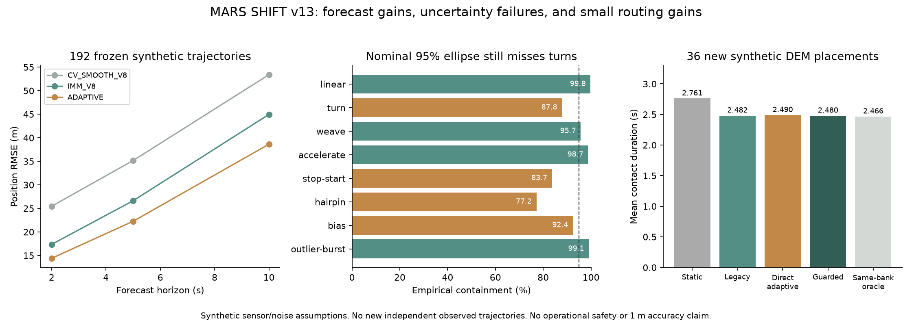

# MARS SHIFT v13 — 적응형 추적, 경로 비교, 검증 결과

2026-11-15. v12 `690b8e7`에서 분리한 고도화 버전이다. 기존 결과와 실패 결과를 보존했다. **예측과 계산 효율은 개선됐다. 대피 성능의 추가 개선은 작으며, 실제 1m급 정확도나 우주비행사 안전성을 검증한 것은 아니다.**

## 1. 실제로 변경한 계산

- 기존 축별 추적을 확장해 **위치·속도 4차원 전체 공분산**을 유지한다. 거리·방위 관측을 좌표로 변환할 때 생기는 북/동 오차의 상관관계를 버리지 않는다.
- 세 일정속도 모델을 서로 다른 가속도 잡음으로 결합하는 IMM을 사용한다. 관측 간격에 따라 상태 전이·잡음·모델 전환 확률을 계산한다. 이는 운동학적 가정이며 화성의 검증된 국소 풍장/CFD가 아니다.
- 큰 정규화 잔차에는 관측 공분산을 제한적으로 키워 영향을 줄인다. 큰 잔차가 오류인지 실제 급회전인지를 완벽하게 구분한다는 뜻은 아니다. 이상 관측을 무조건 제거하지 않는다.
- 새 관측마다 상태만 갱신하는 **증분 처리**를 구현했다. 중복/늦은 패킷은 상태를 되감지 않고 거부한다. 좌표계 변경과 유효하지 않은 공분산도 거부한다. 미래를 조회해도 현재 상태는 바뀌지 않는다.
- 사건 전체에 공통인 거리/방위 체계오차는 독립 관측 잡음처럼 평균내지 않고 별도 공분산으로 남긴다. 실제 체계오차를 측정했다는 의미는 아니다.
- 단독 추적기 교체가 대피를 악화시킨 결과를 확인한 뒤 **기존 예측과 새 예측 양쪽에서 평가한 접촉 위험이 모두 나빠지지 않는 대안 경로만 채택**하는 정책을 추가했다. 두 예측 모두 틀릴 수 있으므로 실제 위험에 대한 보장은 아니다.

연속 백색 가속도 잡음의 시간 전파는 `Q=q[[dt³/3,dt²/2],[dt²/2,dt]]`를 따른다. IMM은 모델 간 평균 차이가 만드는 공분산까지 혼합하며, 측정 갱신은 Joseph 형태로 계산한다. 방법론은 [Stone Soup의 Kalman 설명](https://stonesoup.readthedocs.io/en/stable/auto_tutorials/01_KalmanFilterTutorial.html), [거리·방위 관측 모델](https://stonesoup.readthedocs.io/en/stable/auto_tutorials/02_ExtendedKalmanFilterTutorial.html), [Youn & Myung (2019)의 IMM·모델 불일치 연구](https://doi.org/10.1109/access.2019.2915506)를 참고했다. 마지막 논문의 전체 RIMM 알고리즘을 재현했다거나 화성에 대한 우위를 입증했다는 주장은 하지 않는다. 기존 v8에도 IMM이 있었으며, 이번 기여는 전체 공분산·잔차 처리·증분 갱신·경로 비교의 통합이다.

## 2. 결과를 보기 전에 고정한 새 합성 궤적 검증

`protocol.json`에 입력 생성기, 알고리즘, 후보 네 개, 개발/확인 시나리오, 선택 기준과 해시를 고정했다. 개발용 **96개**에서 평균 위치 제곱오차로 한 후보를 선택하고 `selection.json`에 기록한 뒤, 별도 씨드의 **192개** 확인 궤적을 한 번 평가했다. 확인 결과로 매개변수를 다시 조정하지 않았다.

개발에는 직선·완만한 선회·사행·가속을 사용했다. 확인에는 정지/재출발·급반전·공통 센서 편향·연속 이상 관측도 추가했다. 관측 간격 0.5/1/2/4초, 지연 0/0.5/1/2초, 거리 표준편차 0.5/2/5m, 방위 표준편차 0.2/0.5/1°, 일부 7초 관측 누락을 조합했다. **실제 화성 센서 성능으로 측정된 분포가 아니다.** 운동 속도 등도 선언된 스트레스 조건이지 실측 확률분포가 아니다.

각 모델은 같은 관측을 같은 시각에 받는다. 8–48초의 2초 간격 시점에서 당시 도착한 관측만 사용해 2/5/10초 뒤를 예측했다. 각 모델의 총 4,032개 예측 원점·12,096개 미래 비교가 나오지만 독립 실측 12,096개로 세지 않는다. 새 독립 실측 궤적은 **0개**다.

| 모델 | 전체 위치 RMSE | 2초 예측 | 5초 예측 | 10초 예측 |
|---|---:|---:|---:|---:|
| 기존 CV_SMOOTH | 39.73m | 25.46m | 35.17m | 53.40m |
| 기존 IMM | 31.79m | 17.36m | 26.62m | 44.96m |
| 새 적응형 추적 | **27.05m** | **14.40m** | **22.26m** | **38.63m** |

기존 IMM 대비 RMSE 약 **14.9% 감소**, 기존 CV 대비 약 **31.9% 감소**다. 위치 유지/LAST2/OLS/가중 OLS도 포함했으며 전체 결과는 `confirmation.json`과 `prediction-by-case.csv`에 있다. 사건 단위로 평균 제곱오차 차이를 계산하고 2,000회 paired bootstrap을 수행했다. IMM 대비 평균 차이는 −278.62m², 합성 사건 재표집 구간은 [−450.15, −140.38]m²였다. 실제 화성 일반화에 대한 신뢰구간으로 해석하지 않는다. 192개 중 **47개에서는 기존 IMM보다 나빴다**.

선택된 후보는 `IMM_SLOW`: q=[0.001, 0.04, 1.44] m²/s³, 모델 전환 시간 30초, 잔차 기준 25, 초기 속도 표준편차 10m/s이다. 이 값은 합성 개발 집합에서 선택됐으며 실제 센서 식별 결과가 아니다.

### 남아 있는 예측 실패

| 조건 | 기존 IMM RMSE | 새 추적 RMSE | 새 95% 타원 포함률 |
|---|---:|---:|---:|
| 직선 | 16.11m | 8.74m | 99.8% |
| 선회 | 31.05m | 27.37m | 87.8% |
| 사행 | 38.26m | 29.36m | 95.7% |
| 가속 | 26.05m | 15.50m | 98.7% |
| 정지/재출발 | **30.71m** | 31.80m | 83.7% |
| 급반전 | 52.17m | 51.71m | **77.2%** |
| 공통 편향 | 18.93m | 9.73m | 92.4% |
| 연속 이상 관측 | 26.34m | 12.09m | 99.1% |

개발 집합의 95백분위 NEES로 공분산 배율 2.2488을 고정했으나, 확인 집합의 전체 포함률은 **91.8%**, 평균 장반경은 **38.18m**였다. 95%라는 명목치를 충족하지 않는다. 타원을 크게 표시하는 것과 실제 포함률을 검증하는 것을 구분한다. 고정 방향을 계속 예측하는 모델이 예고되지 않은 급회전·정지를 알 수 없다는 한계가 남아 있다. UI와 보고서에 이 실패를 노출한다.

## 3. 실제 Sol 215 자료의 재생 비교

v12의 NASA PDS 보정 영상·카메라 모델과 논문 근사 거리 110/80/55/30m를 그대로 사용했다. 새 모델을 이 네 점에 맞추어 선택하지 않고 합성 개발 집합에서 고정한 설정을 적용했다. 같은 세 미래 비교 쌍의 결과다.

| 모델 | 재구성 좌표와의 차이 RMSE | 논문 근사 거리와의 차이 MAE |
|---|---:|---:|
| v12 LAST2 | 6.19m | 4.20m |
| v12 가중 속도 | 6.33m | 4.68m |
| v13 적응형 추적 | **3.04m** | **0.86m** |

**0.86m는 '1m급 실측 정확도 달성'이 아니다.** 한 사건의 사후 근사 거리·저자 폭 표식을 이용한 재구성에 대한 일치도다. 가시 먼지 표식은 독립적인 동적 와류 중심이 아니고, 입력과 정답은 공통의 영상 해석 오차를 갖는다. 3개 겹치는 비교에서 좋아졌다고 일반화할 수 없다. 2차원 차이도 3.04m로 거리 차이보다 크다.

보정된 좌표 자체는 v12 그대로이며, v13은 그 좌표의 추적·미래 예측을 바꿨다. 거리/방위 오차 변환에는 거리 잡음과 약 4/740rad의 픽셀 방위 오차 가정을 사용한다. 실제 방위 계측 정밀도를 새로 측정한 값이 아니다. 공통 거리 5%·방위 0.1°도 가정이다. 합성 개발에서 얻은 공분산 배율을 실제 관측 화면에 적용해 '보정된 95% 정확도'로 포장하지 않았다.

가시 먼지 폭의 2/11m 표시는 관측 입력을 유지한다. 동적 와류 직경·팽창률의 실측 예측 정확도를 개선했다는 주장은 없다. 원본·카메라·표식·기각된 초기 지표 교차 접근은 [v12 기록](../metric-v12/report.md), 과학적 원문은 [Murdoch et al. (2022)](https://www.nature.com/articles/s41467-022-35100-z)에 있다.

## 4. 추적기만 교체하면 대피가 나빠진다는 결과

`escape-protocol.json`에 24개 새 합성 배치를 먼저 고정했다. 기존 평지/능선 DEM과 실제 Navcam 지형에서 같은 보행 속도·반응 지연·관측·자원을 적용했다. 정적, 기존 Nominal, 기존 MARS SHIFT, 새 추적기 단독 교체, 같은 후보 경로를 쓰는 완전정보 기준선을 비교했다.

| 모델 | 평균 접촉시간 | 무접촉 | 복귀 실패 | 자원 여유 위반 |
|---|---:|---:|---:|---:|
| 정적 | 2.703s | 17/24 | 0 | 0 |
| 기존 MARS SHIFT | **2.487s** | 18/24 | 0 | 0 |
| 새 추적기 단독 | 2.511s | 18/24 | 0 | 0 |
| 같은 후보의 완전정보 | 2.417s | 18/24 | 0 | 0 |

추적 평균오차가 낮아져도 경로를 결정하는 특정 시점의 예측과 불확실성 폭이 달라지면 접촉이 증가할 수 있다. 확인된 병목은 **추적 점수만으로 경로 엔진 교체를 결정할 수 없다는 것**이다. 단독 교체는 기준을 통과하지 못했고 `promotion:false`로 보존했다. 기존 결과를 덮어쓰거나 좋은 사례만 골라 발표하지 않았다.

## 5. 경로 비교 보완과 새로운 36개 배치

후속 `guard-protocol.json`을 새 배치 결과를 보기 전에 고정했다. 이전 24개에서 임계값을 튜닝하지 않고, 다음의 고정 규칙을 추가했다.

1. 기존 예측으로 생성한 경로와 새 예측으로 생성한 경로를 구한다. 지형·반응·후보 경로·자원 검사 방식은 같다.
2. 두 경로 각각을 **기존/새 예측 × 명목 반경/확장 반경**의 네 조건에서 연속 접촉 검사한다.
3. 네 조건 모두에서 예상 접촉이 악화되지 않고 최소 하나에서 감소하는 경우에만 대안을 채택한다. 같거나 의견이 갈리면 기존 경로를 유지한다.
4. 기존 경로가 자원 조건을 만족하지 못하면 대안으로 이를 우회하지 않는다. 반응 지연도 유지한다.

이 규칙은 예상 위험에 대한 Pareto 비교다. 실제 궤적이 두 예측과 다를 때까지 보장하지 않는다. 새로운 36개 배치는 거리·방향·속도·반응·출현 시각·씨드·자원 조건을 바꿨지만 기존 합성 운동 방정식과 DEM을 재사용했다. 새로운 실제 먼지악마 36개가 아니다.

| 모델 | 평균 접촉시간 | 무접촉 | 복귀 실패 | 경로 계산 p95 |
|---|---:|---:|---:|---:|
| 정적 | 2.761s | 27/36 | 0 | 3.80ms |
| 기존 MARS SHIFT | 2.482s | 27/36 | 0 | 4.00ms |
| 새 추적기 단독 | 2.490s | 27/36 | 0 | 8.15ms |
| **두 예측으로 비교한 경로** | **2.480s** | 27/36 | 0 | **19.56ms** |
| 같은 후보의 완전정보 | 2.466s | 27/36 | 0 | 3.43ms |

정적 대비 평균 접촉시간은 약 **10.2% 감소**다. 기존 MARS SHIFT 대비 추가 감소는 **0.064%**로 아주 작다. 36개 중 1개에서 약 0.058초 개선했고 35개는 같았다. 무접촉률·복귀 실패가 추가 개선됐다는 주장은 하지 않는다. 완전정보 기준도 제한된 동일 후보군을 쓰므로 전역 최적이나 물리적으로 회피 불가능함을 증명하지 않는다.

기존 코드 정의의 불필요한 HOLD는 모든 모델에서 0건이었다. 따라서 추가 감소를 주장하지 않는다. 총 HOLD에는 반응 지연·복귀 후 대기 등이 포함되므로 총 개수만으로 나쁜 정책이라고 판단하지 않는다. 평지/능선/Navcam 각 하위 집합과 전체에서 접촉·복귀 실패가 악화되지 않는 고정 기준은 통과했다. 이 제한된 근거로 **연구용 시연에만** Guarded 정책을 연결했다. 기존 정책들은 설정에서 그대로 비교할 수 있다.

실제 지형에서 똑같은 물리 접촉 정의를 사용했다: 모델의 물리 반경 + 1m 여유, 시간 구간 사이의 연속 교차 검사, 동일 자원 예산과 복귀 검사. 위험 영역은 부상 확률이나 우주복 손상 모델이 아니다. 모든 사례별 이격·접촉·귀환 여유는 `guard-paired-cases.csv`, 시각별 행동 로그는 `guard-results.json`에 있다.



## 6. 계산과 화면 최적화

동일 PC에서 512개 관측 스트림을 네 번 재생하며, 관측 갱신과 2/5/10초 예측을 **양쪽 모두** 포함해 시간을 측정했다. 32개 초기 표본을 제외하고 실행 순서를 번갈아 적용했다.

| 처리 방식 | 중앙값 | p95 |
|---|---:|---:|
| 기존 IMM, 매번 이력 전체 재처리 | 0.507ms | 1.099ms |
| 새 증분 IMM | **0.027ms** | **0.071ms** |

p95 계산시간은 약 **93.5% 감소**했다. 출력이 완전히 동일한 두 구현의 비교는 아니고, 서로 다른 추적기를 같은 관측 길이에서 측정한 CPU 비교다. 네트워크·렌더링·센서 지연은 포함하지 않는다. 실제 경로 비교 정책은 두 경로를 평가하므로 오히려 계산량이 증가했다. 36개 경로 실험에서 19.56ms p95로 기록했으며 '전체 시스템이 15배 빨라졌다'고 주장하지 않는다. `confirmation.json`의 시각별 시간은 새 추적기의 관측 갱신 비용을 포함하지 않으므로 성능 비교 인용에는 **별도 `timing.json`만 사용**한다.

HUD는 전체 2MB 경로 로그와 예측 로그를 읽는 대신 약 **1.9KB 요약 파일**을 사용한다. 실제 영상 화면에서 필요하지 않은 orbital DEM 로딩도 제거했다. 데이터·결과의 원본은 별도 링크로 유지한다.

- `/hazards?metric=sol215`: 실제 Sol 215 영상, 미터 관측, 이전 관측만 사용하는 추적, 2/5/10초 미래 타원, 모든 비교와 실패 표시. 지도 범위를 자동 조절해 예측과 타원이 잘리지 않도록 했다.
- `/hazards`: 기존 고해상도 Sol 477 / Drive 1004 렌더링 유지. 가상 현장 관측으로 Guarded 경로를 계산하고 같은 frame을 헬멧·지도·XR adapter에 전달한다.
- 두 장소의 좌표를 섞지 않는다. 실제 Sol 215 사후 관측을 현재 Sol 477 현장 센서라고 전송하지 않는다.
- 검증 패널에 키보드 초점 순환과 Escape 복귀를 추가했다.

## 7. 검증·재현·남은 한계

전체 **38개 파일·305개 테스트**, TypeScript, production build 및 원본 Navcam 자산 패키징이 통과했다. 새 회귀 검사는 해석적 Kalman 갱신, 시간별 잡음 전파, 회전 불변성, 전체 공분산, 지연/중복, 인과성, 체계오차 유지, 큰 잔차, 기존 경로와의 동등성, 네 위험 조건, 반응 및 자원 제약을 포함한다. 알고리즘 테스트 통과가 현장 정확도 검증은 아니다.

Chrome에서 데스크톱과 390×844 관측 HUD, 예측 타원, 비교표, 키보드 초점, 기존 3D 연결, 24초까지의 관측/행동 갱신, 동일 frame의 헬멧/지도 전환을 확인했다. 해당 시연은 접촉 예측을 숨기지 않고 Move clear와 접촉 예상시간을 함께 표시했다. 브라우저 콘솔 오류는 관측되지 않았다.

```text
node scripts/run_adaptive_v13.mjs freeze
node scripts/run_adaptive_v13.mjs develop
node scripts/run_adaptive_v13.mjs confirm
node scripts/run_adaptive_v13.mjs observed
node scripts/run_escape_v13.mjs freeze
node scripts/run_escape_v13.mjs evaluate
node scripts/run_guard_v13.mjs freeze
node scripts/run_guard_v13.mjs evaluate
node scripts/run_tracker_timing_v13.mjs
python scripts/report_adaptive_v13.py
node node_modules/vitest/vitest.mjs run
```

위 생성 명령은 보존된 결과가 있으면 덮어쓰기를 거부한다. 재실험은 별도 폴더에서 수행해야 한다. report 명령은 원 결과를 변경하지 않고 해시를 확인하며 파생 요약과 그림만 다시 생성한다. `verify_adaptive_v13.mjs`는 새 임시 폴더에서 예측 실험을 재실행하고 타임스탬프·실행시간만 제외해 과학적 결과의 동일성을 검사한다.

남은 핵심은 **독립적으로 측량된 고빈도 중심·경계 궤적과 거리 센서 검증**이다. 이번 고도화는 그것을 새로 확보하지 못했다. 단안 표식과 근사 거리로 만든 0.86m를 실측 1m 정확도라고 바꾸어 말할 수 없다. CFD 없는 바위 주변 불규칙 이동, 갑작스러운 출현/회전, 가시 먼지와 동적 와류 경계의 차이도 해결되지 않았다. 현재 결과는 연구용 비교·시연의 개선이며 실운용 적합 판정이 아니다.

Exa에서 추적 모델/모델 불일치 연구와 공식 오픈소스 수식의 두 방향으로 총 10개 검색 결과를 요청하고 주요 원문을 확인했다(중복 포함, 체계적 문헌고찰 아님). Consensus는 이전 사용량 제한 상태여서 재호출하지 않았다. 참고 논문의 성과 수치를 우리 결과로 사용하지 않았다.
