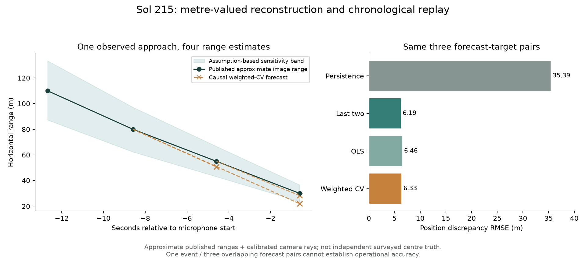
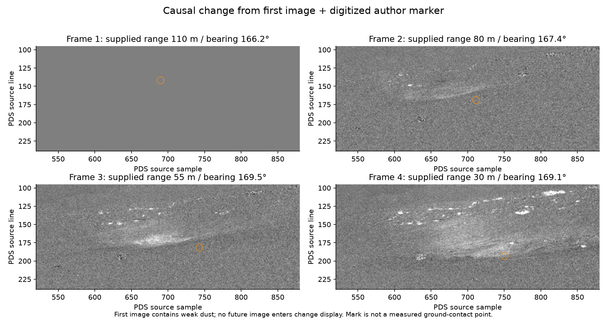

# MARS SHIFT v12 — Sol 215 미터 관측 재구성과 인과적 예측

2026-11-15. **미터 좌표 계산은 구현했지만, 독립적으로 검증된 1m급 위치 정확도는 달성하지 않았다.** 논문의 근사 거리와 NASA 카메라 보정값으로 재구성한 좌표에 대한 예측 비교다. 실제 중심 위치를 측량한 자료에 대한 정확도 평가와 구분해야 한다. 기존 v1–v11 결과와 v12의 실패한 첫 시도도 보존했다.

## 1. 이번에 확보한 관측

- Perseverance **Sol 215, 2021-09-27**, SITE 7 / DRIVE 2050, NCAM00522.
- NASA PDS의 보정된 왼쪽 Navcam 영상 **20장과 XML 20개**. 1280×240, SignedMSB2. SCLK 686020326.323–686020406.284. 촬영 시각을 모든 원본 XML과 대조했다.
- 이 중 논문에서 접근 거리를 설명한 **앞의 4장**을 미터 예측 비교에 사용했다. 20장이 모두 독립적으로 측량된 위치 자료인 것은 아니다. 관측 간격은 약 4초이며 고주파 궤적 정답 자료가 아니다.
- Murdoch et al. (2022)의 본문, Supplementary Information, Supplementary Data, Source Data를 확보했다. 입력은 본문과 보충그림 10–13의 영상 해석이다. 이후 프레임의 '로버가 내부에 있음'을 중심 거리 0m라는 정답으로 바꾸지 않았다.

| 원본 SCLK | 논문의 근사 수평 거리 | 가시 먼지 폭 | 보정 영상의 표식 픽셀 (u,v) |
|---|---:|---:|---|
| 686020326.323 | 약 110m | 약 2m | 689.80, 141.82 |
| 686020330.410 | 약 80m | 약 11m | 711.50, 168.72 |
| 686020334.410 | 약 50–60m; 계산에는 중간값 55m | 약 11m | 742.97, 181.66 |
| 686020338.395 | 약 30m | 약 11m | 750.39, 193.27 |

표식은 저자가 그린 수평 폭 표시를 디지털화한 것이다. **자동 검출한 중심, 지표 접촉점, 독립적인 와류 중심 정답이 아니다.** 표식과 실제 먼지 분포 중심의 편차도 남아 있다. 논문 그림과 원본 영상의 배경 특징을 SIFT/RANSAC으로 정합하여 그림 확대율과 위치를 역변환했다. 정합 인라이어 114–129개는 배경 정합 수이지 먼지 중심 정확도 표본 수가 아니다. 정합 중간값 4개를 `registration/`에 보존했다.

원본 영상의 복사본은 외부 다운로드 캐시에, 정확한 XML·원본 URL·SHA256은 이 폴더에 있다. HUD JPEG의 명암 조절과 변화 강조는 표시용이다. 계측은 원래 픽셀 좌표와 XML 카메라 모델을 사용한다.

## 2. 계산 방법과 연구에서 가져온 구분

1. NASA-AMMOS의 CAHVORE 역투영 구현을 출처·라이선스와 함께 재사용했다. PDS의 type 2, C/A/H/V/O/R/E 및 자세 쿼터니언으로 원본 픽셀을 SITE 북/동/아래 방향 광선으로 변환한다. H/V에 이미 반영된 4배 다운샘플링을 다시 적용하지 않는다.
2. 단안 광선만으로 거리를 알아낼 수 없으므로, **별도로 공급된 거리 관측**과 광선의 교점을 계산한다. 현재 공급자는 논문의 사후 근사 거리다. 카메라와 로버 원점 차이를 광선 원점에 반영하지만 논문 거리의 기준점 자체도 1m 정밀도로 주어진 것이 아니므로, 이를 센티미터급 기준으로 해석하면 안 된다.
3. 그 시점까지의 위치만으로 다음 위치를 예측한다. 위치 유지, 최근 두 관측의 일정 속도, 전체 이력 선형회귀, 거리 오차 가정의 역분산으로 가중한 선형회귀를 같은 시각에 비교했다. 이 자료 규모에서 복잡한 모델을 학습·조정하지 않았다.
4. 논문의 **5.3±0.3m/s, 동적 와류 직경 25±1.56m**는 여러 센서를 사후 결합한 모델 적합 결과다. 예측기에 넣거나 독립 정답으로 사용하지 않았다. 해당 분산은 선택한 상위 네 해의 산포이며 검정된 신뢰구간으로 취급하지 않는다.
5. **가시 먼지 폭, 동적 와류 직경, 안전 여유를 더한 위험 반경**은 다른 양이다. 화면의 2/11m는 가시 폭이며 위험 반경이나 와류 크기 예측 정확도가 아니다. 현재 크기 예측은 마지막 관측 폭 유지일 뿐, 성장 예측 검증을 마쳤다는 주장이 없다.

단일 관측소의 기압·풍속 시계열로 속도·반경·최근접 거리를 유일하게 구할 수 없는 문제가 선행 연구에도 제시된다. 여러 센서의 결합이 필요하며, 사후 전체 사건 적합을 실시간 미래 예측과 혼동하지 않아야 한다. [Lorenz, 단일 관측소 와류 모델의 비유일성](https://pmc.ncbi.nlm.nih.gov/articles/PMC6357969/), [Murdoch et al., 2022](https://www.nature.com/articles/s41467-022-35100-z).

## 3. 고정한 비교와 실제 결과

`ranged-protocol.json`을 결과 생성 전에 기록하고 입력·알고리즘의 바이트 해시를 고정했다. 이전 실패를 본 뒤 만든 후속 실험이라는 사실도 프로토콜에 명시했다. **새로운 독립 사건에 대한 미공개 검증은 아니다.**

- 예측 시점은 관측 2 이후 → 3, 관측 2 이후 → 4, 관측 3 이후 → 4.
- 예측 시간은 각각 4.000초, 7.985초, 3.985초.
- 네 모델 모두 같은 입력과 세 예측 쌍을 사용한다. 현재 평가는 추적기 평가이므로 A* 경로 또는 산소·배터리 성능 비교가 아니다.
- 위치 차이는 이후의 **재구성 좌표**와의 2차원 거리, 거리 차이는 이후의 **논문 근사 거리**와의 차이다. 실제 와류 중심 오차라고 이름 붙이지 않는다.

| 모델 | 위치 차이 RMSE | 거리 차이 MAE | 예측 쌍 |
|---|---:|---:|---:|
| 위치 유지 PERSISTENCE | 35.39m | 33.33m | 3 |
| 최근 두 관측 LAST2 | **6.19m** | **4.20m** | 3 |
| 전체 이력 OLS | 6.46m | 4.97m | 3 |
| 오차 가중 WEIGHTED_CV | 6.33m | 4.68m | 3 |

이 사건에서는 이동 예측이 위치 유지보다 재구성 좌표에 잘 맞았다. 그러나 **새 가중 모델이 단순한 LAST2보다 낫지 않았다.** 이를 최적 모델로 승격하거나 기존 내비게이션의 기본 모델을 바꾸지 않았다. HUD 모델 선택은 비교용이며 기본 표시가 성능 우위를 뜻하지 않는다.

| 시점 → 대상 | 시간차 | LAST2 거리 차이 | 가중 모델 거리 차이 |
|---|---:|---:|---:|
| 관측 2 → 3 | 4.000s | −4.28m | −4.28m |
| 관측 2 → 4 | 7.985s | −8.05m | −8.05m |
| 관측 3 → 4 | 3.985s | +0.27m | −1.70m |

단일 +0.27m 사례를 '27cm 정확도'라고 주장하면 안 된다. 목표 거리 자체가 약 30m이고 독립 중심 측량값이 아니다. 세 쌍은 동일 사건에서 겹치는 이력을 사용하므로 독립 표본 세 개로 신뢰구간·유의확률을 계산하지 않았다. 모든 12행은 `forecast-metrics.csv`, 전체 결과는 `ranged-results.json`에 있다.



## 4. 왜 아직 1m급이라고 할 수 없는가

가장 큰 병목은 복잡한 예측 모델의 부족보다 **거리와 중심 위치 정답의 부족**이다.

- 해당 영화에는 오른쪽 카메라의 동시 관측이 확보되지 않아 실제 스테레오 거리를 측정하지 못했다. 삼각측량 함수는 해석적 회귀 테스트만 통과했다.
- 논문의 근사 거리가 입력이자 미래 비교 기준이다. 서로 공통의 영상 해석·좌표 보정 오차를 공유한다.
- 저자의 폭 표식은 중심 표식이 아니다. 변화 강조 영상에서도 표식과 먼지 분포 중심의 차이가 보인다.
- 영상 간격 약 4초 동안 5.3m/s 물체는 약 21m 이동할 수 있다. 이는 논문의 속도를 사용한 설명용 산술이며 새 예측기의 검증 성능이 아니다.
- 이 재구성의 추정 속도 약 6–7m/s와 논문 적합값 5.3m/s의 차이는 근사 거리·표식 편향·가시 구름과 와류 중심의 차이로 설명될 가능성이 있다. 원인을 이 네 점으로 분리할 수 없다. 논문 속도에 맞추려고 결과를 사후 보정하지 않았다.
- 2/5/10초 HUD 미래 점은 계산값이다. 마지막 유효 관측 뒤에는 비교할 중심 정답이 없다.

거리 10%, 최소 3m의 표준편차 가정, 픽셀 4px, 사건 공통 거리 축척 5%, 공통 방위 0.1°를 전파한 2,000개 몬테카를로 표본을 사용했다. 거리에 5%/20%를 적용한 민감도 결과도 포함했다. **가정에 따른 분포이지 실제 95% 정확도 보증이 아니다.** 현재 30m 관측의 수평 위치 민감도 반경 95백분위는 약 6.52m, 110m 관측에서는 약 23.27m다.



변화 영상은 현재 영상과 첫 영상의 비 및 행별 중앙값 제거를 사용한다. 첫 영상에도 약한 먼지가 있으므로 차분 기준의 오염이 있다. 미래 영상을 빼서 현재 검출을 유리하게 만들지 않았다.

## 5. 실패한 첫 접근도 보존

초기 `protocol.json` / `results.json`은 저자의 거리·폭 막대를 지표 접촉점으로 해석하고 평면 지형과 교차하는 접근이다. 논문 그림을 다시 검토한 결과 이 가정이 성립하지 않았다. **그 결과는 유효한 정확도 벤치마크로 사용하지 않는다.** 파일을 덮어쓰지 않고 `audit.json`과 새 프로토콜에 기각 이유를 남겼다.

`inputs.json`의 지형 보정 관련 필드와 일부 한계 문구도 그 초기 기록의 일부다. 현재 ranged 모델은 그 지형 평면을 사용하지 않고 별도 거리 관측을 요구한다. 현재 유효한 결과는 **`ranged-results.json`**이다.

## 6. HUD와 기존 XR 통합

`/hazards?metric=sol215`는 실제 Sol 215 영상을 헬멧 디스플레이 형태로 재생한다. 거리·방위·속도, 관측 이력과 미래 예측, 가시 폭, 시간, 오차 가정에 따른 범위를 표시한다. 네 모델 선택, 실제 촬영 간격의 2배속 재생, 변화 강조, 검증표를 제공한다.

기존 고해상도 Sol 477 / Drive 1004 3D 시연은 유지하고 Evidence 패널에서 연결했다. 두 관측은 다른 장소다. **Sol 215 궤적을 Sol 477 지형에 실제 위치처럼 얹지 않았다.** 거리 공급자 인터페이스는 동기화 스테레오·거리 센서를 추가할 수 있지만 현재 연결된 공급자는 논문 자료뿐이다.

`authorizeMetricOverlay`는 사후 자료/미검증 거리, 다른 좌표계, 오래되거나 미래인 관측, 여유 거리보다 큰 오차를 거부한다. 이 함수만으로 실제 대피 적합성이 입증되는 것은 아니다. 이번 변경으로 실제 위험 노출·귀환 실패가 감소했다고 주장하지 않는다. 그 비교에는 동일 좌표계의 검증된 궤적과 지형이 먼저 필요하다.

## 7. 1m급 목표를 검증하려면

다음 데이터 수집과 평가를 별도 사건에서 수행해야 한다. 아래는 아직 달성하지 않은 조건이다.

1. **목표부터 고정:** '중심의 수평 위치', '가시 먼지 경계', '위험 경계' 중 무엇인지 지정하고 1m를 RMSE인지 95백분위인지, 현재 위치인지 2/5/10초 예측인지 구분한다. 현재 위치의 1m 오차가 10초 예측의 1m 오차를 뜻하지 않는다.
2. **독립 거리 확보:** 동기화된 다중 시점·거리 센서와 시간/외부자세 보정, 별도의 측량 기준을 확보한다. 거리 오차 δR와 방위 오차 δθ가 작은 경우 횡방향 오차는 대략 R·δθ다. 두 항과 자세·시간·중심 정의 오차를 함께 예산화해야 한다. 100m에서 0.01rad만으로도 약 1m이므로 거리만 정밀하게 만들어서는 부족하다.
3. **관측·전송 지연 측정:** 감지, 영상 노출, 추정 완료, 경로 완료, 표시, 이동 시작을 분리 기록한다. 5m/s에서 0.2초 시각 오차만으로 약 1m의 위치 불일치가 가능하다. 원본 타임스탬프 보존과 지연 보정이 필요하다.
4. **사건 단위 독립 검증:** 동일 영화의 프레임을 무작위로 나누지 않고 사건/날짜/장소 단위로 분할한다. 튜닝은 개발 사건에만 하고 모든 실패·가림·급회전·정지·먼지 확산 사례를 고정 검증 집합에서 보고한다. 영상 수를 독립 사건 수로 세지 않는다.
5. **측정 및 예측을 분리:** 관측 위치·경계 오차, 2/5/10초 ADE/FDE, 불확실성 구간의 실제 포함률/폭, 검출 누락·잘못된 연결·계산 지연을 사건별로 평가한다. 단순 일정속도보다 복잡한 모델이 여러 독립 사건에서 낫다는 근거가 있어야 교체한다.
6. **경로 검증:** 동일 DEM·속도·반응지연·자원으로 정적/이동/통합/완전정보 모델을 사례별 비교한다. 연속 구간 접촉 검사와 귀환까지 포함한다. 추적 오차와 접촉 정의가 고정된 뒤 무접촉률·접촉시간·최소 이격·귀환 실패·계산시간을 보고한다. 이번 좌표 재생으로 이 단계를 통과했다고 대체하지 않는다.

## 8. 재현과 변경 이력

실행 위치는 v12 저장소 루트다. Python 환경에는 numpy/scipy/Pillow/matplotlib가 필요하며 원본 그림의 재정합을 다시 연구하려면 PyMuPDF와 OpenCV가 필요하다. 보존된 registration JSON을 사용하는 현재 재생에는 OpenCV가 필요 없다.

```text
python scripts/acquire_metric_v12.py --verify-only
node scripts/verify_metric_replay_v12.mjs
node node_modules/vitest/vitest.mjs run
node node_modules/typescript/bin/tsc -b
node node_modules/vite/bin/vite.js build
node scripts/package_navcam_assets.mjs
```

캐시가 없는 환경에서는 `--verify-only` 없이 acquisition을 실행한다. 고정된 해시와 일치하는 공개 원본만 저장하고 기존 파일을 덮어쓰지 않는다. 원본 API가 다른 바이트를 제공하면 자동 대체하지 않고 중단한다.

`verify_metric_replay_v12.mjs`는 매번 새 임시 폴더에서 두 고정 실험을 재계산한다. 생성 시각 필드만 제외하고 모든 결과 필드가 보존된 결과와 동일한지 확인한다. 이번 실행에서 두 결과의 동일성을 확인했고 원래 결과는 변경하지 않았다.

`prepare_metric_v12.py`, `run_metric_v12.mjs freeze/evaluate`, `run_ranged_v12.mjs freeze/evaluate`는 최초 생성용으로 결과가 있으면 덮어쓰기를 거부한다. 재실험은 기존 결과를 지우지 말고 별도 출력 폴더/버전으로 복제해야 한다. 그림만 재생성하려면 `python scripts/report_metric_v12.py --refresh-figures`를 사용한다.

원자료의 본문과 두 실험의 입력/코드 해시를 확인했으며, 전체 36개 테스트 파일·291개 테스트와 TypeScript/배포 빌드가 통과했다. 새 7개 테스트는 광선/좌표 회전, 해석적 삼각측량, 크기와 독립적인 거리 입력, 시간순 예측, 좌표계·지연·오차 조건을 검증한다. 테스트 통과가 관측 정확도 검증은 아니다. 브라우저에서 데스크톱·390×844 모바일, 모델 변경, 재생 종료, 검증표와 Escape, 기존 3D와 왕복을 확인했다. 검증 중 공통 nav 높이 스타일의 침범을 수정했다.

## 9. 근거와 검색 범위

- [Murdoch et al. (2022), The sound of a Martian dust devil](https://www.nature.com/articles/s41467-022-35100-z) 및 [Table 1](https://www.nature.com/articles/s41467-022-35100-z/tables/1).
- 실제 확보한 [본문 XML](https://www.ebi.ac.uk/europepmc/webservices/rest/PMC9747922/fullTextXML), [보충 자료 archive](https://www.ebi.ac.uk/europepmc/webservices/rest/PMC9747922/supplementaryFiles). 자료의 모델 Monte Carlo 해 20,000개를 실측 궤적 20,000개로 세지 않았다.
- [NASA PDS Sol 215 calibrated Navcam](https://planetarydata.jpl.nasa.gov/img/data/mars2020/mars2020_navcam_ops_calibrated/data/sol/00215/ids/rdr/ncam/), [Mars 2020 PDS 안내](https://pds-imaging.jpl.nasa.gov/volumes/mars2020.html).
- [NASA-AMMOS CameraModelUtilsJS](https://github.com/NASA-AMMOS/CameraModelUtilsJS). `cahvore.js` blob `f2297a9d221fc673f19c28bad51aea3b780aaa35`. Apache 2.0 원문과 별도 출처 기록은 `src/vendor/`에 있다.
- [PDS geometry dictionary](https://pds.nasa.gov/datastandards/documents/dd/all/current/ch34s03.html).
- [단일 관측소 와류 모델의 비유일성 연구](https://pmc.ncbi.nlm.nih.gov/articles/PMC6357969/).

Exa에서 데이터·논문 보충자료·원본 촬영 제품·공식 카메라 모델 네 방향으로 검색했고 총 22개 결과를 요청했다(중복 포함, 체계적 문헌고찰의 고유 논문 수가 아님). Consensus는 월 사용량 제한 응답으로 추가 검색이 불가능하여 Exa와 공개 원문을 사용했다. 실패한 HTML 다운로드 두 개는 원자료로 사용하지 않았고 manifest에 제외 이유를 기록했다.
