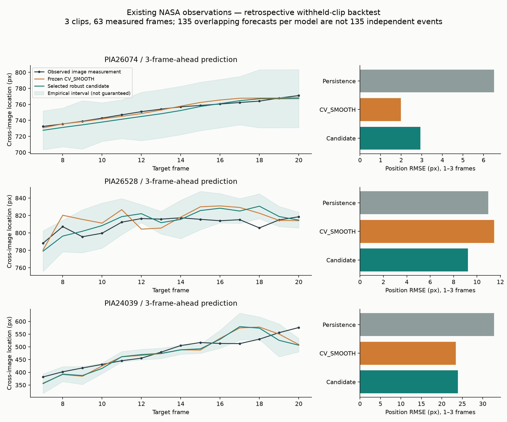
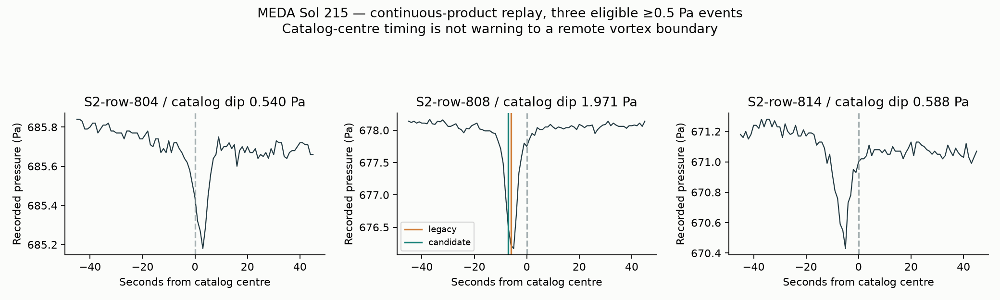

# 기존 실측 자료 백테스트와 헬멧 HUD — v11

2026-11-15. **실제 관측 기록을 정답 자료로 사용한 구성 요소 백테스트를 완료했다. 새 예측·탐지 후보는 채택 기준을 통과하지 못했다.** 기존 v10 대피 정책은 유지하고, 실측 검증 결과와 한계를 HUD 근거 패널에 연결했다. 이전 실험은 덮어쓰지 않았다.

## 사용 자료와 검증 가능한 범위

| 자료 | 실제로 사용한 양 | 검증한 항목 | 검증할 수 없는 항목 |
|---|---:|---|---|
| NASA PIA26074, PIA26528, PIA24039 영상 | 3개 영상, 각 21프레임, 총 63프레임 | 다음 프레임의 영상상 가로 위치, 겉보기 폭, 이동 부호 | 미터 단위 2D 중심·진짜 소용돌이 경계·현장 대피 성공 |
| PDS MEDA Sol 57 기압 | 58,662개 표본, 공통 평가 구간 16.045시간 | 탐지기 개발·선택 | 먼 거리에서의 위치·이동 방향 추정 |
| PDS MEDA Sol 215 기압 | 49,401개 표본, 공통 평가 구간 13.361시간 | 선택 후 날짜를 분리한 탐지 평가 | 원격 위험 경계 도착 경고시간 |
| Hueso 논문 Table S2 | 위 두 날의 사건 4개/14개 | 기압 사건 시각과 카탈로그 일치 | 모든 사건이 먼지를 포함한다는 증명, 독립적인 중심 궤적 |

기압 원본 총 **108,063개 표본**을 처리했다. 유효 관측 사이의 공백은 보간하지 않았다. 공백 뒤 100초를 공통 준비 구간으로 두고, 연속 관측 구간 내에서만 평가했다. 카탈로그의 0.5 Pa 이상 사건은 각 날 3개씩이다. 나머지 1개/11개는 미리 정한 주 평가 범위보다 약한 사건으로, 실패를 보고 제외한 것이 아니다. 원본에 없는 센서 불확실성을 0으로 만들지 않았다.

영상에는 실제 관측 영상에서 추출한 가로 위치와 FWHM 폭을 썼다. FWHM은 밝은 먼지 기둥의 측정 정의이며 물리적 위험 직경이 아니다. ROI는 기존에 사람이 선정한 범위다. 위치 추출은 프레임별 공간 필터를 사용하지만 NASA의 영상 보정 과정과 ROI 선택까지 실제 온라인 센서로 검증한 것은 아니다. 기존 측정 도표에서 약한 초기 신호와 폭·가시성 변화도 확인했다. 별도의 독립 정답 주석자가 제공한 위치는 아니다.

PIA26074는 4초 간격, PIA26528은 약 6초 간격이다. PIA24039는 전체 길이로부터 균일한 12.75초 간격을 가정한 기존 자료이므로 이 영상의 초 단위 선행시간은 별도 표시했다. 주 비교는 **1/2/3프레임 선행 예측**이다. 세 영상을 같은 초 단위 성능으로 합치거나 픽셀 오차를 미터로 환산하지 않았다.

## 선행 연구에서 실제로 도입한 절차

Exa 검색 요청은 두 주제의 첫 시도 10건이 인자 검증에서 실패했고, 재시도 10건과 표본 수 관련 5건은 정상 조회했다. 즉 정상 검색 결과 15건을 검토했다. 별도로 먼지악마 실측 연구, 대피 실험, 예측 평가 방법의 핵심 원문을 읽었다. 체계적 전수 문헌고찰은 아니다.

| 근거 | 실험·모델 구성에서 배운 점 | 이번 적용 |
|---|---|---|
| [Toledo 외 2023, 지상 MEDA-RDS 검증](https://www.frontiersin.org/journals/astronomy-and-space-sciences/articles/10.3389/fspas.2023.1221726/full) | 1 Hz 광센서, 약 25 m 떨어진 두 관측 지점, 카메라와 거리 표식으로 추정값 대조. 센서 시야 진입·이탈·최대 신호 시간을 직선 이동 모델에 맞추고 관측 불일치를 벌점으로 처리. 일부 자료는 크기와 속도를 따로 식별하지 못함 | 단일 기압이나 광학 크기를 독립 2D 궤적으로 간주하지 않음. 입력·추정·검증 자료의 역할과 식별 한계 명시 |
| [Hueso 외 2023](https://doi.org/10.1029/2022je007516) | 다양한 시간 창과 기압 하강 기준으로 사건 목록을 만들고 압력·바람 모델을 사후 적합. 탐색 창 양끝의 자료를 쓰는 방식은 실시간 경고와 다름 | 실제 Table S2 시각과 SCLK를 직접 연결. 사후 카탈로그와 과거 자료만 사용하는 탐지기를 분리. 0.5 Pa 이상을 주 평가 범위로 사전 고정 |
| [Chen 외 2023, 쓰나미 대피](https://nhess.copernicus.org/articles/23/733/2023/) | 설문·대피 훈련 자료로 이동·출발 지연을 구성하고 지형과 결합; 속도·지연·행동의 민감도를 별도 비교 | 센서 예측 검증과 우주비행사 이동·대피 검증을 분리. 지구의 보행·반응 값을 검증된 화성 값으로 전용하지 않음 |
| [Hewamalage 외, 예측 평가 방법](https://pmc.ncbi.nlm.nih.gov/articles/PMC9718476/) | 시간 순서 보존, 여러 선행시간 평가, 단순하지만 강한 기준선, 모델 선택과 최종 평가의 분리 | 매 예측은 그 시점까지의 표본만 사용. Persistence·최근 속도·선형회귀·기존 필터를 함께 비교. 영상별 선택/구간 보정/평가 역할 분리 |

이전의 [NIST 화재 대피 모형 검토](https://nvlpubs.nist.gov/nistpubs/TechnicalNotes/NIST.TN.1822.pdf)에서 확인한 구현 검증과 실험 검증의 구분도 유지했다. 논문의 과정을 따르는 것이 그 논문의 검증 수준을 자동으로 얻었다는 뜻은 아니다.

## 모델 구성과 자료 분할

프로토콜과 입력·엔진 SHA-256을 평가 전에 저장했다. 이미지 후보는 최근 3/5/7프레임의 쌍별 기울기 중앙값과 절편 중앙값을 이용하는 강건한 선형 추정이다. 선행시간에 따라 속도를 유지하거나 감쇠하고, 폭은 마지막 값 또는 최근 3값 중앙값을 선택한다. 12개 설정만 비교했다. 설정 선택 손실은 관측 시작점의 겉보기 폭으로 정규화한 위치·폭 절대오차다. 이 정규화는 영상별 크기 차이를 줄이기 위한 것이며 미터 단위 보정이 아니다.

영상마다 서로 다른 역할을 순환했다. 한 영상으로 설정을 선택하고, 다른 영상으로 선행시간별 경험적 오차 구간을 보정한 다음, 남은 영상에서 평가했다. 예측 구간은 보정 영상의 절대오차 90% 분위수를 이용한다. 겹치는 시계열 오차는 독립·교환 가능하지 않으므로 명목 90%가 보장되는 conformal interval이라고 부르지 않는다. 구간 폭도 함께 보고했다.

모든 모델은 처음 5프레임 뒤 동일한 시점에서 평가한다. 영상당 45개, 모델당 135개 예측은 서로 겹치므로 **독립 사건은 3개**다. 영상들은 이전 버전에서 이미 연구한 자료다. 이번 분리 절차에서 평가 영상이 선택·보정에 들어가지 않았어도, 프로젝트 전체에서 새로 봉인된 외부 검증 자료가 되는 것은 아니다. 연대순 미래 사건 예측 성능을 입증한 것도 아니다.

기압 후보는 현재 시점 이전 30/60/90초 중 최근 5초를 제외한 자료로 배경 추세를 추정한다. 과거 잔차 MAD와 최소 하강량 0.5/0.8 Pa를 이용하며 2/3회 연속 확인한다. Sol 57에서 12개 설정 중 카탈로그 일치 F1이 가장 높은 설정을 선택하고, 동률이면 카탈로그 밖 알림이 적은 설정과 미리 고정한 순서로 결정했다. 이 F1은 완전한 참·거짓 정답에 대한 정확도가 아니다.

기존 탐지기의 30초 중앙값·0.8 Pa·3회 확인은 유지했다. 비교 시 공통 준비 구간과 60초 알림 간격을 적용했다. 원래의 선별된 180초 주변 창만 평가한 결과와 달리 전체 확보 기압 제품을 재생했다. 두 모델 모두 같은 관측 범위에서 ±30초 이내 최근접 일대일 카탈로그 매칭을 적용하고, ±10/60초 민감도도 함께 계산했다.

## 실제 결과

| 영상 | 기존 CV_SMOOTH 위치 RMSE | 선택 후보 RMSE | 선택 후보 위치 구간 포괄률 | 평균 위치 구간 전체 폭 |
|---|---:|---:|---:|---:|
| PIA26074 | 1.978 px | 2.937 px | 100.0% | 43.93 px |
| PIA26528 | 11.453 px | 9.224 px | 80.0% | 24.60 px |
| PIA24039 | 23.394 px | 23.946 px | 86.7% | 57.80 px |

영상별 RMSE를 동일 비중으로 평균하면 후보가 약 **1.95%** 낮다. 그러나 2개 영상에서는 위치 오차가 증가했다. 사전 기준인 10% 이상 개선, 어느 영상도 위치·폭 오차가 악화되지 않을 것, 모든 영상의 위치 포괄률 90% 이상을 충족하지 못했다. 폭 MAE는 0.467/4.089/5.156 px로 기존의 0.511/4.311/5.522 px보다 작았지만 위치 예측 실패를 상쇄하지 못한다. 첫 영상의 100% 포괄률도 구간이 매우 넓어 정밀도가 높다는 뜻은 아니다.

단순 기준선도 중요했다. PIA26074에서는 최근 두 점 속도 모델이 1.693 px, PIA24039에서는 기존 LOCAL7이 17.332 px였다. 한 영상의 사후 최고 모델을 골라 합친 결과를 운용 모델의 성능으로 보고하지 않았다. 전체 8개 모델·선행시간별 표는 [CSV](image-metrics.csv)에 있다.

| MEDA 평가일 Sol 215 | 기존 탐지기 | 개발일에서 선택한 후보 |
|---|---:|---:|
| 0.5 Pa 이상 평가 가능한 카탈로그 사건 | 3개 | 3개 |
| 일치 사건 | 1/3 | 1/3 |
| 미탐 | 2개 | 2개 |
| 카탈로그 밖 알림 | 0개 | 0개 |
| 평가 시간 | 13.361 h | 13.361 h |
| 일치 사건의 카탈로그 중심 대비 선행 | 6초 | 7초 |

매칭 허용치를 10/30/60초로 바꿔도 결과는 같았다. 개발일 Sol 57에서는 두 모델 모두 3/3이었지만 평가일에서는 1/3이었다. **기압 탐지 후보도 채택 기준을 통과하지 못했다.** 카탈로그 밖 알림 0건을 실제 오경보율 0%로 해석하지 않는다. 탐지한 압력 와류가 반드시 먼지 기둥을 동반하지도 않는다. 6·7초는 점 센서에서의 사후 압력 중심 시각과의 차이이며, 우주비행사에게 위험 경계가 오기 전 주어진 경고시간이 아니다.

## 실패 원인과 적용 판단

- **약한 사건의 대표성 부족:** 개발일의 주 평가 사건은 1.444/2.728/3.522 Pa였고, 0.5–0.8 Pa의 약한 사건이 없었다. 따라서 개발일 100% 탐지를 근거로 낮은 압력 하강량에서도 검증됐다고 판단할 수 없다.
- **온라인 배경과 사후 배경의 차이:** 평가일 0.540 Pa 사건의 과거 자료 기반 최대 하강량은 약 0.433 Pa로 후보의 0.5 Pa 기준에 미달했다. 사후 카탈로그 진폭이 그대로 온라인 탐지량이 되는 것은 아니다.
- **확인 지연의 비용:** 0.588 Pa 사건은 후보 하강량이 한 표본에서 약 0.576 Pa였지만 앞 표본은 약 0.498 Pa, 뒤 표본은 약 0.227 Pa여서 2회 연속 조건을 만족하지 못했다. 잡음 억제를 위한 확인 조건이 짧은 사건을 놓쳤다.
- **영상 간 전이 실패:** 합쳐지는 기둥·가시성 변화·약한 신호가 같은 이동 모델에 동일하게 맞지 않았다. 속도 감쇠는 한 영상에 도움을 줄 수 있지만 매끄럽게 이동하는 다른 영상에서는 지연 오차를 키웠다. 프레임 간격과 카메라 기하도 다르다.
- **폭 측정의 한계:** 영상의 좁은 밝은 영역이 줄어드는 현상은 위험 반경이 실제로 줄어든다는 정답이 아니다. 배경 제거·임계값·기둥 기울기의 영향을 분리해야 한다.

결과를 본 뒤 같은 평가일에 임계값을 낮춰 성공 수치를 다시 만들지 않았다. 현 단계에서는 v10의 가상 위치 센서 기반 대피 정책을 유지한다. 이번 영상 후보를 미터 단위 경로 계산에 이식하지 않았다. 새로운 실측 백테스트 결과와 연구 한계는 HUD에서 바로 확인할 수 있게 연결했다.

## 어느 수준까지 검증해야 하는가

1. **현재 통과한 범위:** 출처·단위·시간 정렬, 과거 자료만으로 예측하는 구현, 공백 처리, 같은 시점 기준선 비교, 선택/보정/평가 분리, 원본 결과 보존. 이는 구성 요소 연구의 최소 절차다.
2. **다음 예측 채택 단계:** 서로 다른 관측일·거리·직경·명암·직진/선회·센서 누락 조건을 포함한 별도 사건을 확보한다. 위치·폭 오차뿐 아니라 실패 영상 비율, 선행시간별 오차와 경험적 구간 포괄률·폭을 보고한다. 같은 사건의 프레임 수를 늘리는 것으로 사건 다양성을 대신하지 않는다.
3. **미터 단위 경로 연결 단계:** 시간 동기화된 카메라 기하·거리 표식·복수 시점 등으로 중심과 반경의 독립 기준을 만든다. 위치 등록·반경·예측 오차를 합친 여유가 실제 경로의 최소 이격거리보다 작아야 한다. 요구 정확도는 임의의 '1 m'가 아니라 지형 폭, 소용돌이 크기·속도, 센서/반응/계산 지연으로 결정해야 한다.
4. **대피 결합 검증:** 같은 지형·속도·지연·자원으로 정적/이동 예측/통합/완전정보 참고 모델을 비교한다. 관측 궤적에 사람을 가상 배치한 실험은 관측에 제약된 시뮬레이션이며 실제 사람이 대피한 검증과 구분한다. 경고 전후의 접촉, 지형 통과 불가, 귀환, 거부·HOLD 이유, 종단 지연을 기록한다.
5. **충분한 표본의 의미:** 단 하나의 고정 숫자로 모든 사용 조건을 검증할 수 없다. 예를 들어 동일 분포의 독립 사건에서 실패가 0일 때, 단측 95% 이항 상한은 `1−0.05^(1/n)`이다. 3건이면 실패율 상한이 약 63.2%이고, 59건에서 0실패라야 약 5%, 299건에서 0실패라야 약 1%다. 이것은 수학적 예시이며 실제 안전 승인 기준이 아니다. 공통 관측일·기상 조건으로 묶인 사례와 연속 프레임에는 이 독립 가정을 그대로 적용하면 안 된다. [NIST 정확 이항 신뢰구간](https://www.itl.nist.gov/div898/software/dataplot/refman2/auxillar/exacbici.htm)

현재는 3개 영상과 2개 관측일이므로 실제 EVA 운용 수준의 정확도·안전성은 입증하지 못했다. 우주복 손상·헤드셋 안전성은 이번 범위에 넣지 않았다.

## HUD와 재현 자료

화면은 실제 Navcam 지형 위의 1인칭 시점을 유지하고, 헬멧 안쪽 테두리·얇은 투사 표식·시선 기준 방향 화살표·잔여 산소/배터리·위치 상태로 구성했다. 화면 고정 HUD와 지형 고정 경로를 구분한다. 위치 σ 0.75 m는 가상 센서 설정으로 명시한다. 관측 자료 검증 패널에서 실패 결과도 표시한다.

- [사전 프로토콜](protocol.json), [영상 전체 예측](image-results.json), [영상 예측 CSV](image-forecasts.csv)
- [기압 개발·선택](pressure-selection.json), [기압 평가](pressure-results.json), [원본 제품에서 추출한 기압 입력·출처](pressure-input.json), [진단·해시](diagnostics.json)
- 입력 생성: `python scripts/prepare_observed_v11.py` (기존 캐시만 사용, 원본 해시 검증)
- 순서: `node scripts/run_observed_v11.mjs freeze` → `images` / `pressure-development` → `pressure-evaluation`
- 도표: `python scripts/report_observed_v11.py` (NumPy·Matplotlib 환경)
- 기존 출력이 있으면 덮어쓰기를 거부한다. 새 실행은 별도 작업 공간/출력 경로를 사용한다. 모델·평가 코드를 바꾸면 새로운 프로토콜을 등록해야 한다.

자동 테스트 35파일/284개, TypeScript 검사와 production build를 통과했다. HUD 브라우저 검증은 별도 검증 기록에 남긴다.
